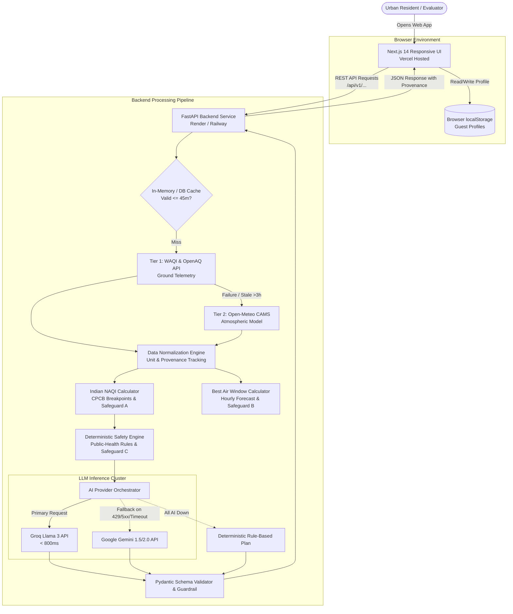

# BreatheWise AI — Product Requirements Document (PRD)

**Document Version:** 1.1  
**Status:** Approved Architecture & Development Baseline  
**Project:** PromptWars Virtual — Challenge 6: Urban Air Quality Assistant  
**Product Type:** GenAI-powered, Responsive Web Application (Local-first with Optional Cloud Sync)  
**Target Delivery:** 3-Day Sprint (Hackathon MVP with Production-Ready Foundation)  
**Primary Objective:** Deliver practical, verifiable, and pollution-aware daily lifestyle guidance for Indian households by coupling authoritative multi-tier environmental data with deterministic safety guardrails and contextual generative AI.

---

## 1. Executive Summary & Product Principles

BreatheWise AI is an Urban Air Quality Assistant designed specifically for urban Indian households. It bridges the gap between raw, abstract air-quality numbers (e.g., "AQI 280", "PM2.5 165 µg/m³") and practical daily decisions: *When should I open my windows? Is it safe for my child to attend outdoor sports practice today? How do I mitigate cooking smoke in an apartment? What lower-emission commute options make sense without increasing personal exposure?*

The product explicitly avoids becoming a generic chatbot or a static dashboard. It operates on a **hybrid architectural model**: hard public-health constraints and air quality calculations are executed **deterministically in code**, while generative AI (Groq Llama 3 primary, Google Gemini backup) is reserved for **personalization, scheduling, and natural-language explanations**.

```
+----------------------------------------------------------------------------------------------------+
|                                    BREATHEWISE AI CORE PILLARS                                     |
+------------------------------------+-----------------------------------+---------------------------+
| 1. Low-Emission Daily Routines     | 2. Indian Indoor Air Intelligence | 3. Sustainable Choices   |
| Practical, pollution-aware travel, | Wet mopping vs dry sweeping,      | Lower-emission transit    |
| school, exercise, and errands      | tadka/frying exhaust management,  | without compromising      |
| timed around air quality.          | ventilation, and purifier usage.  | personal exposure safety. |
+------------------------------------+-----------------------------------+---------------------------+
```

### Core Product Principles

1. **Data Before AI:** Outdoor AQI and pollutant concentrations must originate from verified data providers, never inferred or generated by an LLM.
2. **Deterministic Safety:** Generative AI is never permitted to independently declare an activity "safe" or override public-health guidelines. Safety boundaries are calculated deterministically.
3. **Honest Data Provenance:** Ground observations, atmospheric model estimates, and historical caches must be clearly labeled in the UI. Missing or stale data must be explicitly disclosed.
4. **Context-Sensitive Guidance (No Blankets):** Universal blanket mandates (e.g., "everyone must wear N95 indoors", "never leave the house") are prohibited. Guidance must be graded, source-backed, and practical for Indian living conditions.
5. **Guest-First & Privacy-Preserving:** The application must be instantly usable without mandatory signup or authentication. Sensitive personal and health data is strictly minimized.
6. **Zero Cross-User Plan Leakage:** While public environmental observations are cached globally, personalized daily plans containing user routines are never cached across different users.

---

## 2. Problem Statement & Urban Indian Context

Urban residents across Indian metropolitan areas (Delhi NCR, Mumbai, Bengaluru, Kolkata, Chennai, Hyderabad, etc.) face extreme seasonal and diurnal variations in air quality driven by meteorological inversions, vehicular traffic, construction dust, biomass burning, and cooking practices.

Standard air-quality applications fail Indian households in three distinct ways:
- **Abstract Metric Fatigue:** Displaying "AQI 320" creates anxiety but offers no actionable schedule (e.g., whether pollution will temporarily dip at 2:00 PM).
- **Western Bias in Indoor Guidance:** Advice such as "turn on central HVAC" or "install MERV-13 filters" is irrelevant for typical Indian homes relying on natural cross-ventilation, split ACs, and wet-mopping routines.
- **Unsafe Sustainability Suggestions:** Generic green apps frequently suggest walking or cycling during hazardous pollution episodes, paradoxically increasing heavy particulate inhalation by 300% to 500%.

BreatheWise AI solves these problems through culturally intelligent, deterministic, and exposure-aware planning.

---

## 3. Target Users & Personas

| Persona ID | Target Profile | Key Decisions & Unique Needs |
|---|---|---|
| **Persona A** | **Parent / Household with Children** | Safe outdoor playtime; school commute precautions; managing respiratory sensitivities; indoor particulate control during homework/sleep hours. |
| **Persona B** | **Senior Citizen / Vulnerable Household** | High sensitivity to PM2.5 and Ozone; early morning walk alternatives; indoor air filtration timing; zero strenuous exertion during poor air events. |
| **Persona C** | **Student / Fitness Enthusiast / Athlete** | Timing outdoor running, cycling, or campus commutes; rescheduling workouts to lower-exposure windows or substituting with indoor bodyweight routines. |
| **Persona D** | **Working Professional / Commuter** | Exposure trade-offs between two-wheelers, auto-rickshaws, metro, and cabs; timing office departures; trip consolidation. |
| **Persona E** | **General Urban Resident** | Quick daily orientation; home ventilation timing; basic actionable precautions without complex configuration. |

---

## 4. Scope & Feature Prioritization (P0 / P1 / P2)

To satisfy the 3-day hackathon delivery while building a production-grade core, features are prioritized into strict tiers. **P1 and P2 features must never delay the completion and verification of P0 requirements.**

```
+--------------------------------------------------------------------------------------------------+
| P0: MANDATORY CORE (Days 1 & 2)                                                                  |
| - Multi-tier air quality data ingestion (WAQI -> OpenAQ v3 -> Open-Meteo CAMS -> Unavailable).   |
| - Indian National AQI (NAQI) breakpoint and sub-index calculation engine with limitations.      |
| - Multi-city support (covering major Indian metro centers).                                      |
| - Guest-First onboarding via browser localStorage with pre-configured sample evaluator profiles. |
| - Deterministic Safety Engine enforcing CPCB public-health constraint boundaries.               |
| - Dual AI Provider Architecture: Groq (Llama 3 primary) with automatic Google Gemini fallback.   |
| - Structured Daily Planner (Morning, Afternoon, Evening) with Post-AI constraint validation.     |
| - Indian Household Intelligence (wet mopping, tadka exhaust management, ventilation precautions).|
| - Sustainable alternatives with exposure trade-off rationale (no unsupported numerical claims).  |
| - Provenance, timestamp, stale data, and error state indicators across all UI cards.             |
+--------------------------------------------------------------------------------------------------+
| P1: HIGH-VALUE ENHANCEMENTS (Day 3 Morning)                                                      |
| - Best Air Window calculation (comparatively favorable ventilation, outdoor, and hazard hours).  |
| - Locality and monitoring station selector for supported metro cities.                           |
| - Optional Supabase Authentication (Google OAuth / Magic Link) for cross-device profile sync.    |
| - 24-hour pollutant trend visualization (Recharts).                                              |
| - Open-Meteo weather context integration (wind speed, temperature, humidity).                   |
+--------------------------------------------------------------------------------------------------+
| P2: POST-HACKATHON HORIZON (Postponed)                                                           |
| - Interactive Leaflet GIS maps with real-time station heatmap layers.                            |
| - WhatsApp / SMS proactive push notifications for morning air alerts.                           |
| - Multi-point commute route pollution exposure comparison.                                       |
| - Hardware IoT air purifier integration via MQTT/Home Assistant.                                 |
+--------------------------------------------------------------------------------------------------+
```

---

## 5. Multi-Tier Air Quality Ingestion Architecture

Because Indian air-monitoring feeds can suffer from sporadic telemetry downtime, BreatheWise AI implements a resilient, multi-tier data ingestion pipeline with strict provenance tracking.

```
                           +------------------------------------------+
                           | User Selects City / Station / Locality   |
                           +--------------------+---------------------+
                                                |
                                                v
                           +--------------------+---------------------+
                           | Check In-Memory / Supabase Cache         |
                           | (Freshness window: <= 45 minutes)        |
                           +---------+----------------------+---------+
                                     |                      |
                              [Cache Hit]              [Cache Miss]
                                     |                      |
                                     v                      v
                             Return Cached        +---------+--------------------+
                              Observation         | TIER 1: Ground Station Query |
                                                  | Primary: WAQI API (CPCB/PCB) |
                                                  | Secondary: OpenAQ API v3     |
                                                  +---------+--------------------+
                                                            |
                                               +------------+------------+
                                               |                         |
                                        [Valid Ground Data]       [Failed / Stale >3h]
                                               |                         |
                                               v                         v
                                      Normalize Observation    +---------+--------------------+
                                      Data Status: "live_ground| TIER 2: Atmospheric Model    |
                                                               | Open-Meteo CAMS Model API    |
                                                               +---------+--------------------+
                                                                         |
                                                            +------------+------------+
                                                            |                         |
                                                    [Valid Model Data]          [Model Failed]
                                                            |                         |
                                                            v                         v
                                                  Normalize Observation     +---------+--------------------+
                                                  Data Status: "model_est"  | TIER 3: Unavailable State    |
                                                                            | Show last known observation  |
                                                                            | or graceful unavailable card |
                                                                            +------------------------------+
```

### 5.1 Provider Specifications

| Tier | Provider | Endpoint Pattern | Auth | Response Normalization |
|---|---|---|---|---|
| **Tier 1 (Primary Ground)** | **WAQI API** (aggregating CPCB/SPCB) | `https://api.waqi.info/feed/{city}/?token={KEY}` or `feed/@{station_id}/` | API Key (`token`) | Extracts `iaqi.pm25.v`, `iaqi.pm10.v`, `iaqi.no2.v`, `time.iso`, station name, coordinates, attribution (`attributions[].name`). |
| **Tier 1 (Secondary Ground)** | **OpenAQ v3 API** | `https://api.openaq.org/v3/locations/{id}/latest` | Header `X-API-Key` | Fallback if WAQI station is unavailable. Normalizes parameter IDs to standard `pm25` / `pm10` concentrations. |
| **Tier 2 (Model Fallback)** | **Open-Meteo Air Quality** (CAMS) | `https://air-quality-api.open-meteo.com/v1/air-quality?latitude={lat}&longitude={lng}&current=pm2_5,pm10&hourly=pm2_5,pm10` | Open / None | Used when Tier 1 ground stations are missing, offline, or older than 3 hours. Tagged explicitly as `model_estimate`. |
| **Tier 3 (Unavailable)** | **Deterministic Fallback** | N/A | None | Displays last cached reading if under 24h old (tagged `stale`), or an explicit error state: *"No active ground stations or atmospheric forecasts available for this area."* |

### 5.2 Provenance & Freshness Rules
- **Freshness Window:** Observations are considered **live** if `observed_at` $\le 3\text{ hours}$ old. Observations between 3 and 12 hours old are marked **stale**. Observations older than 12 hours trigger Tier 2 model fallback.
- **Strict Anti-Conflation:** Under no circumstances are ground-station readings blended, averaged, or concatenated with model estimates. The UI badge must unequivocally state either:
  - 🟢 **Live Ground Station** (e.g., *"CPCB Monitor — RK Puram, Delhi"*), or
  - 🔵 **Atmospheric Model Projection** (e.g., *"ECMWF CAMS Regional Model"*).

---

## 6. Indian National AQI (NAQI) Engine & Safeguards

### 6.1 Official CPCB Breakpoint Methodology
To comply with **Safeguard A**, BreatheWise AI calculates the Indian NAQI sub-index using the official Central Pollution Control Board (CPCB) linear interpolation equation:

$$I_p = I_{low} + \frac{I_{high} - I_{low}}{B_{high} - B_{low}} \times (C_p - B_{low})$$

Where:
- $C_p$ is the pollutant concentration.
- $[B_{low}, B_{high}]$ is the concentration breakpoint bracket.
- $[I_{low}, I_{high}]$ is the corresponding sub-index bracket.

#### Official Indian Breakpoints Table (24-Hour Averaging Standards)

| CPCB Category | Sub-Index Range | $\text{PM}_{2.5}$ ($\mu\text{g/m}^3$) | $\text{PM}_{10}$ ($\mu\text{g/m}^3$) | $\text{NO}_2$ ($\mu\text{g/m}^3$) | $\text{SO}_2$ ($\mu\text{g/m}^3$) | $\text{CO}$ ($\text{mg/m}^3$) |
|---|---|---|---|---|---|---|
| **Good** | 0 – 50 | 0 – 30 | 0 – 50 | 0 – 40 | 0 – 40 | 0 – 1.0 |
| **Satisfactory** | 51 – 100 | 31 – 60 | 51 – 100 | 41 – 80 | 41 – 80 | 1.1 – 2.0 |
| **Moderate** | 101 – 200 | 61 – 90 | 101 – 250 | 81 – 180 | 81 – 380 | 2.1 – 10.0 |
| **Poor** | 201 – 300 | 91 – 120 | 251 – 350 | 181 – 280 | 381 – 800 | 10.1 – 17.0 |
| **Very Poor** | 301 – 400 | 121 – 250 | 351 – 430 | 281 – 400 | 801 – 1600 | 17.1 – 34.0 |
| **Severe** | 401 – 500 | $> 250$ | $> 430$ | $> 400$ | $> 1600$ | $> 34.0$ |

### 6.2 The Minimum Pollutant Rule & Labeling Constraints
1. **The Official NAQI Rule:** According to CPCB standards, a true official Indian NAQI can only be reported if at least **3 pollutants** are measured, of which at least one must be either $\text{PM}_{2.5}$ or $\text{PM}_{10}$.
2. **Labeling Safeguard:**
   - If 3+ pollutants including particulate matter are present, display: **"Indian National AQI"**.
   - If only $\text{PM}_{2.5}$ and/or $\text{PM}_{10}$ are available (common in many urban sensors), the UI **must not** label this as the "Official National AQI". It must be explicitly rendered as:  
     **"Calculated Particulate Sub-Index ($\text{PM}_{2.5}$ dominant)"** with an explanatory disclosure: *"Calculated based on CPCB particulate breakpoints. Complete multi-pollutant NAQI unavailable for this station."*
   - If the provider passes through an external AQI (such as WAQI's US EPA-converted number), display: **"Provider Reported Index (US EPA scale)"** alongside the raw concentrations.

---

## 7. Deterministic Safety Rules Engine

To satisfy **Safeguard C**, all public-health constraints are derived deterministically in Python before invoking any generative AI. Generative models are barred from making autonomous safety determinations.

### 7.1 Safety Constraint Matrix

| Calculated AQI / Sub-Index Band | General Population Constraints | Vulnerable Group Constraints (Children, Elderly, Respiratory/Cardiac) | Ventilation Guidance | Commute / Mask Guidance |
|---|---|---|---|---|
| **Good (0–50)** | Normal outdoor physical activities permitted. | Normal outdoor activities permitted. | Unrestricted natural cross-ventilation encouraged. | No protective mask required. Walking / cycling actively encouraged. |
| **Satisfactory (51–100)** | Normal outdoor activities permitted. | Minor breathing discomfort possible for highly sensitive individuals; monitor symptoms. | Natural ventilation suitable throughout the day. | Walking / cycling encouraged. Sensitive individuals note heavy traffic zones. |
| **Moderate (101–200)** | Prolonged strenuous outdoor exertion may cause breathing discomfort. Take periodic breaks. | Sensitive individuals avoid prolonged intense outdoor exertion; shift workouts indoors. | Open windows during middle daylight hours; close during evening traffic peak. | Consider cloth/surgical mask near high-traffic corridors for dust; active transit acceptable. |
| **Poor (201–300)** | Breathing discomfort to most people on prolonged exposure. Avoid morning jogs during peak smog. | Strictly avoid outdoor exercise and running. Suspend outdoor school sports. | Limit window opening to 1–2 hours during midday dispersion window; seal otherwise. | Well-fitted N95 recommended for two-wheeler / auto-rickshaw commutes exceeding 20 minutes. |
| **Very Poor (301–400)** | Respiratory illness on prolonged exposure. Move workouts indoors. | Remain indoors. Suspend all outdoor playtime for children. High vulnerability alert. | Keep windows sealed. Run indoor HEPA filtration if available. Wet mop surfaces. | N95 recommended for all outdoor transit. Avoid open two-wheeler travel where feasible; use metro. |
| **Severe (401–500+)** | Severe respiratory impact. Healthy people experience symptoms. Avoid non-essential outdoor trips. | Strict indoor confinement. Vulnerable individuals monitor peak oxygen / inhaler readiness. | Keep all windows and doors sealed. Minimize opening exterior doors. | Avoid all non-emergency outdoor exposure. N95/FFP2 essential for necessary transit. Metro/closed vehicle. |

### 7.2 Post-AI Validation & Sanitization Guardrail
After Groq or Gemini returns a generated daily plan, a deterministic validation hook inspects the output:
```python
def validate_plan_against_constraints(plan: DailyPlanResponse, constraints: SafetyConstraints) -> DailyPlanResponse:
    for period in [plan.morning, plan.afternoon, plan.evening]:
        for rec in period:
            # Rule: If severe/very poor, no intense outdoor activity allowed
            if constraints.outdoor_activity_allowed is False and rec.is_outdoor and rec.intensity in ["moderate", "high"]:
                rec.action = constraints.fallback_indoor_activity
                rec.caution = "Outdoor activity modified by BreatheWise Safety Engine due to hazardous air conditions."
                rec.is_outdoor = False
            # Rule: Enforce mask guidance if required
            if constraints.mask_guidance_level == "n95_recommended" and rec.commute_context and "mask" not in rec.action.lower():
                rec.caution = (rec.caution or "") + " Note: N95/FFP2 respirator advised during open transit."
    return plan
```

---

## 8. Best Air Window Feature (P1)

To satisfy **Safeguard B**, BreatheWise AI introduces a data-driven **"Best Air Window"** recommendation card.

```
+----------------------------------------------------------------------------------------------------+
| BEST AIR WINDOW TODAY                                                   [Status: Comparative Est.]  |
+----------------------------------------------------------------------------------------------------+
| 🟢 Favorable Window: 01:30 PM – 03:30 PM (Expected: Moderate, ~75 µg/m³)                           |
|    Rationale: Solar boundary layer expansion temporarily disperses surface particulate matter.     |
|    Action: Comparatively better window for essential outdoor errands and brief cross-ventilation.   |
|                                                                                                    |
| 🔴 Peak Hazard Window: 06:30 AM – 09:00 AM (Expected: Very Poor, ~180 µg/m³)                       |
|    Rationale: Morning surface temperature inversion traps vehicular and biomass emissions.          |
|    Action: Seal windows; avoid outdoor physical exertion.                                          |
+----------------------------------------------------------------------------------------------------+
```

### 8.1 Calculation Engine & Nuanced Terminology Rules
1. **Source Data:** The engine fetches 24-hour forward projections of hourly $\text{PM}_{2.5}$, $\text{PM}_{10}$, and wind speed from **Open-Meteo Air Quality**.
2. **Evaluation Window:** Restricted to daytime hours ($06:00\text{ to }20:00$).
3. **The "Non-Absolute" Terminology Rule (Safeguard B):**
   - If the lowest forecasted $\text{PM}_{2.5}$ remains in the **Poor** or **Very Poor** band (e.g., dipping from $280\,\mu\text{g/m}^3$ to $140\,\mu\text{g/m}^3$), the window **must never** be labeled "Safe".
   - The UI must use the phrase: **"Comparatively Better Window"** or **"Lowest Exposure Window"**, accompanied by a clear disclosure:  
     *"Air quality remains in the unhealthy range; this window represents the diurnal minimum for necessary tasks."*
4. **Fallback Handling:** If hourly forecast data is missing, the response returns `air_window_status: "unavailable"` and explains: *"Diurnal forecast model unavailable for this location today. Follow general daily precautions."*

---

## 9. Indian Household Intelligence (P0)

BreatheWise AI incorporates specific, practical indoor air guidance designed for Indian urban residences:

1. **Wet Mopping vs. Dry Sweeping:**
   - Dry sweeping (traditional *jharoo*) resuspends settled coarse dust ($\text{PM}_{10}$) into the breathing zone for hours.
   - Guidance: Recommend **wet mopping (*pocha*) with a damp cloth** during elevated pollution days to physically capture particulates without aerosolizing them.
2. **Tadka & High-Heat Cooking Emissions:**
   - Indian tempering (*tadka* with mustard oil, ghee, dry chilies, spices) generates intense localized indoor $\text{PM}_{2.5}$ spikes exceeding $500\,\mu\text{g/m}^3$ in seconds.
   - Guidance: Advise running kitchen exhaust fans at high speed, keeping the kitchen door closed to prevent smoke migration into bedrooms, and ensuring passive back-drafting is minimized.
3. **Inversion & Natural Ventilation Timing:**
   - Winter inversion traps smoke near the ground during dawn and late night.
   - Guidance: Prohibit early-morning window opening (5:00 AM – 8:30 AM). Guide ventilation toward early afternoon (1:00 PM – 3:30 PM) when ground warming breaks the inversion layer.
4. **Air Purifiers & Natural Plants Disclosure:**
   - Purifiers: Advise running HEPA purifiers in closed bedrooms during night hours; clean pre-filter mesh bi-weekly.
   - Scientific Honesty: Explicitly debunk the myth that potted plants (e.g., Snake Plant, Areca Palm) can meaningfully cleanse high ambient indoor $\text{PM}_{2.5}$.

---

## 10. AI Provider Architecture & Resilient Failover

```
                     +---------------------------------------------+
                     | Frontend / Client Request                   |
                     +----------------------+----------------------+
                                            |
                                            v
                     +----------------------+----------------------+
                     | FastAPI AI Manager (ai_manager.py)          |
                     | Injects Validated Data + Safety Constraints |
                     +----------------------+----------------------+
                                            |
                     +----------------------+----------------------+
                     | PRIMARY ATTEMPT: Groq (Llama 3 70B/8B)      |
                     | Timeout: 4500ms                             |
                     +----------------------+----------------------+
                                            |
                               +------------+------------+
                               |                         |
                           [Success]               [Eligible Failure]
                               |                   - Timeout / Connection Fail
                               |                   - HTTP 429 Rate Limit
                               |                   - HTTP 500 / 502 / 503
                               |                         |
                               |                         v
                               |           +-------------+--------------------+
                               |           | BACKUP ATTEMPT: Google Gemini    |
                               |           | (Gemini 1.5 Flash / 2.0 Flash)   |
                               |           | Timeout: 6000ms                  |
                               |           +-------------+--------------------+
                               |                         |
                               |            +------------+------------+
                               |            |                         |
                               v            v                     [Failure]
                     +---------+------------+----+                    |
                     | Pydantic Schema Validator |                    v
                     | Post-AI Constraint Guard  |        +-----------+--------------------+
                     +---------------------------+        | DETERMINISTIC FALLBACK PLAN    |
                                                          | Pre-computed safe guidance     |
                                                          | based entirely on CPCB matrix. |
                                                          +--------------------------------+
```

### 10.1 Failover & Error Classification

| Condition | Groq Action | Gemini Fallback Action | Final Result |
|---|---|---|---|
| HTTP 200 (Valid JSON) | Validate schema $\rightarrow$ return | Not called | Personalized AI Plan |
| HTTP 429 (Rate Limit) | Catch exception $\rightarrow$ switch | Invoke immediately | Gemini Plan |
| Timeout (>4.5s) | Cancel request $\rightarrow$ switch | Invoke with 6.0s timeout | Gemini Plan |
| HTTP 5xx Server Error | Log error category $\rightarrow$ switch | Invoke immediately | Gemini Plan |
| Both Providers Fail | Catch exception | Log provider outage | **Deterministic Rule-Based Fallback Plan** (Zero crash) |
| HTTP 400 (Bad Request) | **Do not fallback**; bug in prompt schema | **Do not fallback** | Return HTTP 500 internal error |
| HTTP 401/403 (Invalid Key) | **Do not fallback**; config error | **Do not fallback** | Log alert; trigger deterministic plan |

### 10.2 Cache Architecture & User Privacy
- **Public Observations Cache:** Raw environmental readings from WAQI and Open-Meteo are cached in backend memory or Supabase for **30 to 45 minutes** keyed by `station_id` or `city`.
- **Zero Cross-User Plan Caching:** **Personalized AI plans are never cached across different users.** Because plans contain custom family routines, commute timings, and vulnerability profiles, sharing plans between users risks severe privacy leakage.
- **Client-Side Cache:** The client browser caches its *own* generated daily plan in `localStorage` for the current calendar date to eliminate redundant API calls upon page reload.

---

## 11. Technical Architecture & Component Stack

### 11.1 Technology Stack Table

| Layer | Selection | Rationale & Trade-off Consideration |
|---|---|---|
| **Frontend Framework** | **Next.js 14+ (App Router, TypeScript)** | High performance, server-side rendering for meta tags, typed component tree. |
| **Styling & UI Library** | **Tailwind CSS + shadcn/ui + Lucide Icons** | Accessible, responsive, mobile-first design with clean visual hierarchy. |
| **State & Storage** | **Browser `localStorage` (Zustand optional)** | Zero-friction Guest-First onboarding; zero evaluator login barriers. |
| **Backend Framework** | **FastAPI (Python 3.11+)** | Native async I/O, strict Pydantic v2 data models, fast execution. |
| **Data Validation** | **Pydantic v2** | Strict schema validation for external APIs and generative AI JSON payloads. |
| **Primary AI Inference** | **Groq API (`llama-3.1-70b-versatile` or `8b`)** | Blazing inference speed (<700ms TTFT), generous hackathon tier. |
| **Backup AI Inference** | **Google Gemini API (`gemini-1.5-flash` or `gemini-2.0-flash`)** | High uptime, large context window, reliable structured JSON mode. |
| **Ground Air Quality** | **WAQI API + OpenAQ API v3** | Real-time CPCB/SPCB ground telemetry with attribution provenance. |
| **Atmospheric Model & Weather**| **Open-Meteo Air Quality & Weather API** | Free, unauthenticated CAMS model fallback and hourly forward forecasts. |
| **Database & Auth (Optional P1)**| **Supabase (PostgreSQL + RLS)** | Hosted PostgreSQL for observation history and optional user profile sync. |
| **Visual Charts** | **Recharts** | Clean responsive SVG 24-hour pollutant and diurnal curve visualization. |
| **Frontend Hosting** | **Vercel** | Instant continuous deployment, Edge network, zero cold starts. |
| **Backend Hosting** | **Render (Free Tier) / Railway / Koyeb** | Fast Docker/Python deployment with cold-start mitigation pinger. |

### 11.2 End-to-End System Architecture



---

## 12. Pydantic Response Schemas & Data Contracts

These schemas are the single source of truth for backend serialization, AI output validation, and frontend rendering.

```python
from pydantic import BaseModel, Field
from typing import List, Optional, Literal
from datetime import datetime

# ==============================================================================
# 1. AIR QUALITY & PROVENANCE SCHEMAS
# ==============================================================================

class PollutantConcentration(BaseModel):
    value: float = Field(..., description="Observed or estimated numerical value")
    unit: str = Field(default="µg/m³", description="Measurement unit (e.g., µg/m³, mg/m³)")
    sub_index: Optional[float] = Field(None, description="Calculated CPCB sub-index for this pollutant")

class NormalizedAirObservation(BaseModel):
    city: str
    locality_or_station: Optional[str] = None
    station_distance_km: Optional[float] = None
    data_tier: Literal["tier1_ground", "tier2_model", "tier3_unavailable"]
    data_provider: str = Field(..., description="e.g., 'WAQI (CPCB Feed)', 'OpenAQ', 'Open-Meteo CAMS'")
    observed_at: datetime
    fetched_at: datetime
    freshness_status: Literal["live", "stale", "partial", "unavailable"]
    
    # Official vs Calculated Index Distinctions (Safeguard A)
    index_type: Literal["official_naqi", "calculated_particulate_subindex", "provider_index", "model_estimate"]
    index_value: Optional[int] = None
    index_category: Literal["Good", "Satisfactory", "Moderate", "Poor", "Very Poor", "Severe", "Unavailable"]
    methodology_disclosure: str = Field(..., description="Transparent explanation of how index was determined")
    
    # Raw Pollutant Readings
    pm25: Optional[PollutantConcentration] = None
    pm10: Optional[PollutantConcentration] = None
    no2: Optional[PollutantConcentration] = None
    so2: Optional[PollutantConcentration] = None
    co: Optional[PollutantConcentration] = None

# ==============================================================================
# 2. HOUSEHOLD PROFILE & SAFETY CONSTRAINTS
# ==============================================================================

class HouseholdProfile(BaseModel):
    profile_id: str
    display_name: Optional[str] = "My Household"
    city: str
    preferred_station_id: Optional[str] = None
    persona: Literal["parent", "senior", "athlete", "commuter", "general"]
    age_groups: List[Literal["infant_toddler", "child", "adult", "senior"]]
    has_respiratory_sensitivity: bool = False
    has_cardiovascular_sensitivity: bool = False
    commute_mode: Optional[Literal["two_wheeler", "open_auto", "metro_train", "closed_car", "walking", "none"]] = None
    has_air_purifier: bool = False
    kitchen_ventilation_type: Literal["exhaust_fan", "chimney", "window_only", "none"] = "exhaust_fan"

class SafetyConstraints(BaseModel):
    aqi_band: str
    outdoor_activity_allowed: bool
    max_outdoor_intensity: Literal["none", "light_only", "moderate", "unrestricted"]
    vulnerable_quarantine_recommended: bool
    mask_guidance_level: Literal["not_required", "optional_traffic_zones", "n95_recommended", "n95_essential"]
    ventilation_restriction: Literal["unrestricted", "daylight_window_only", "sealed_mandatory"]
    fallback_indoor_activity: str

# ==============================================================================
# 3. BEST AIR WINDOW & DAILY PLAN SCHEMAS
# ==============================================================================

class AirWindowItem(BaseModel):
    time_window: str = Field(..., description="e.g., '01:30 PM - 03:30 PM' or 'Not recommended today'")
    is_favorable: bool = Field(..., description="True if window represents meaningful exposure reduction")
    expected_aqi_band: str = Field(..., description="e.g., 'Moderate', 'Poor'")
    rationale: str = Field(..., description="Atmospheric explanation (e.g., inversion breakup)")
    actionable_instruction: str = Field(..., description="Action to take during this window")

class BestAirWindowResponse(BaseModel):
    status: Literal["available", "comparative_only", "unavailable"]
    confidence_level: Literal["high", "moderate", "low", "unavailable"]
    ventilation_window: Optional[AirWindowItem] = None
    safe_outdoor_window: Optional[AirWindowItem] = None
    peak_hazard_window: Optional[AirWindowItem] = None
    advisory_note: str = Field(..., description="Safeguard B disclaimer regarding comparative safety")

class PlanRecommendation(BaseModel):
    action: str
    timing: str
    reason: str
    is_outdoor: bool
    intensity: Literal["none", "light", "moderate", "high"] = "none"
    caution: Optional[str] = None
    data_context_used: str

class DailyPlanResponse(BaseModel):
    generated_at: datetime
    ai_provider_used: Literal["groq", "gemini", "deterministic_fallback"]
    data_provenance: NormalizedAirObservation
    safety_constraints: SafetyConstraints
    best_air_windows: Optional[BestAirWindowResponse] = None
    
    # 3-Period Daily Routine (P0)
    morning: List[PlanRecommendation]
    afternoon: List[PlanRecommendation]
    evening: List[PlanRecommendation]
    
    # Challenge Pillars (P0)
    indoor_guidance: List[str]
    sustainable_alternatives: List[str]
    scientific_disclaimers: List[str]
```

---

## 13. Guest-First & Local Storage Data Model

To eliminate onboarding friction for users and evaluators, BreatheWise AI operates **100% functional without user login**.

```
+----------------------------------------------------------------------------------------------------+
| LOCALSTORAGE SCHEMA: 'breathewise_guest_state'                                                      |
+----------------------------------------------------------------------------------------------------+
{
  "selected_city": "Delhi NCR",
  "preferred_station_id": "cpcb_rk_puram_delhi",
  "profile": {
    "profile_id": "guest_550e8400_e29b",
    "persona": "parent",
    "age_groups": ["child", "adult"],
    "has_respiratory_sensitivity": true,
    "commute_mode": "two_wheeler",
    "has_air_purifier": true,
    "kitchen_ventilation_type": "exhaust_fan"
  },
  "cached_plan": {
    "date": "2026-11-24",
    "plan_payload": { ... }
  }
}
```

### Pre-Configured Sample Evaluator Profiles
The onboarding modal includes a single-click **"Load Sample Profile"** selector:
1. **Sample 1: Delhi NCR Family (High Vulnerability)** — 6-year-old child with mild asthma, two-wheeler school commute, exhaust fan present. Demonstrates severe AQI safety overrides.
2. **Sample 2: Bengaluru Runner (Athlete)** — Outdoor morning fitness enthusiast, metro commuter. Demonstrates outdoor exercise window rescheduling.
3. **Sample 3: Mumbai Senior Citizen** — 68-year-old walking enthusiast, ground-floor apartment. Demonstrates indoor ventilation and gentle morning alternatives.

---

## 14. Database Schema (Optional Supabase P1)

When Supabase is enabled for user persistence in P1, the following PostgreSQL schema with Row Level Security (RLS) is applied:

```sql
-- Profiles table (synced when user logs in via Supabase Auth)
CREATE TABLE public.profiles (
    id UUID PRIMARY KEY REFERENCES auth.users(id) ON DELETE CASCADE,
    display_name TEXT,
    city TEXT NOT NULL DEFAULT 'Delhi NCR',
    persona TEXT NOT NULL CHECK (persona IN ('parent', 'senior', 'athlete', 'commuter', 'general')),
    household_config JSONB NOT NULL DEFAULT '{}'::jsonb,
    created_at TIMESTAMPTZ NOT NULL DEFAULT timezone('utc'::text, now()),
    updated_at TIMESTAMPTZ NOT NULL DEFAULT timezone('utc'::text, now())
);

ALTER TABLE public.profiles ENABLE ROW LEVEL SECURITY;
CREATE POLICY "Users can only read own profile" ON public.profiles FOR SELECT USING (auth.uid() = id);
CREATE POLICY "Users can only update own profile" ON public.profiles FOR UPDATE USING (auth.uid() = id);
CREATE POLICY "Users can insert own profile" ON public.profiles FOR INSERT WITH CHECK (auth.uid() = id);

-- Global Air Quality Observation Cache (Public read, Service write)
CREATE TABLE public.air_quality_cache (
    id UUID PRIMARY KEY DEFAULT gen_random_uuid(),
    station_or_city_key TEXT NOT NULL UNIQUE,
    provider TEXT NOT NULL,
    data_tier TEXT NOT NULL,
    raw_payload JSONB NOT NULL,
    observed_at TIMESTAMPTZ NOT NULL,
    fetched_at TIMESTAMPTZ NOT NULL DEFAULT timezone('utc'::text, now())
);

CREATE INDEX idx_air_cache_key ON public.air_quality_cache(station_or_city_key);
ALTER TABLE public.air_quality_cache ENABLE ROW LEVEL SECURITY;
CREATE POLICY "Public read access to air cache" ON public.air_quality_cache FOR SELECT TO anon, authenticated USING (true);
```

---

## 15. API Specifications (FastAPI Endpoints)

| Method | Endpoint | Purpose | Request Body / Query Params | Response Object |
|---|---|---|---|---|
| `GET` | `/health` | Service health & wake-up check | None | `{"status": "ok", "timestamp": "...", "version": "1.1"}` |
| `GET` | `/api/v1/cities` | List supported Indian metro cities & default coordinates | None | `List[CityMetadata]` |
| `GET` | `/api/v1/stations` | List available monitoring stations for a city | `?city=Delhi+NCR` | `List[StationMetadata]` |
| `GET` | `/api/v1/air-quality` | Retrieve normalized live/fallback air observations | `?city=Delhi&station_id=...` | `NormalizedAirObservation` |
| `GET` | `/api/v1/air-window` | Retrieve calculated 24h best air windows (P1) | `?city=Delhi&lat=...&lng=...` | `BestAirWindowResponse` |
| `POST`| `/api/v1/plan/generate`| Generate personalized daily plan with safety constraints | `HouseholdProfile` + Air context | `DailyPlanResponse` |

---

## 16. Edge Cases & Resilience Engineering

| Edge Case Scenario | System Response & Required UI Behavior |
|---|---|
| **Selected city has zero active ground stations** | Fall back to Tier 2 (Open-Meteo CAMS atmospheric model). Badge: *"Atmospheric Model Estimate"*. Disclose lack of local sensor. |
| **WAQI station reports stale data (>3 hours old)** | Flag as `stale`. Query Open-Meteo model. If model is fresher, display model reading with clear comparison disclosure. |
| **Only PM2.5 is measured (No PM10 or NO2)** | Calculate PM2.5 sub-index. Label as **"Calculated Particulate Sub-Index"**. Disclose that official multi-pollutant NAQI requires 3+ pollutants. |
| **Open-Meteo hourly forecast fails / times out** | `best_air_windows` returns `status: "unavailable"`. UI collapses the window card gracefully and relies on daily plan periods. |
| **Groq API hits HTTP 429 Rate Limit** | Automatically divert payload to Google Gemini within 200ms. Response headers record `x-ai-provider: gemini-fallback`. |
| **Both Groq and Gemini APIs are down** | Invoke `deterministic_fallback_planner()`. Output complete, safe, structured daily plan based strictly on the CPCB safety matrix. |
| **Render backend is in cold-start state (~50s)** | Frontend landing page executes a warming `/health` ping on load; shows a branded wake-up indicator: *"BreatheWise AI is activating real-time air engines (~20s)..."* |
| **Evaluator opens app without profile configuration** | UI defaults to Guest Mode with pre-populated "Sample Delhi Family" state; app is 100% interactive on first click. |
| **User submits prompt-injection text in profile label** | Profile fields are strongly validated by Pydantic; strings are escaped; LLM system prompt isolates user text within strict JSON variables. |

---

## 17. Security, Privacy & Public Health Disclaimers

### 17.1 Security & Secret Management
- **Zero Secrets on Client:** Groq API keys, Gemini API keys, WAQI tokens, and Supabase service keys remain exclusively on the FastAPI backend.
- **Environment Isolation:** Keys stored in `.env` (git-ignored); `.env.example` committed with empty placeholders.
- **CORS Restrictions:** FastAPI configured with strict CORS origins allowing only the deployed Vercel domain and `localhost:3000`.

### 17.2 Mandatory Public Health Disclaimer (Safeguard C)
The following persistent disclaimer must be accessible in the web application footer and within the generated plan modal:

> **Important Public Health Advisory:**  
> *"BreatheWise AI provides environmental information and lifestyle exposure-reduction guidance based on available ground and satellite telemetry. It is not an authorized medical device, clinical diagnostic tool, or emergency broadcast service. Air quality and atmospheric conditions vary significantly across micro-environments. Individuals with pre-existing respiratory or cardiovascular conditions should prioritize personalized guidance from qualified healthcare professionals."*

---

## 18. Three-Day Development Sprint Roadmap

```
+----------------------------------------------------------------------------------------------------+
| DAY 1: FOUNDATION & MULTI-TIER DATA INGESTION                                                      |
| [X] Initialize Next.js 14 frontend and FastAPI backend repositories.                              |
| [X] Implement WAQI API integration with station-level parsing.                                    |
| [X] Implement Open-Meteo CAMS fallback integration.                                               |
| [X] Build Normalization Engine & Indian NAQI Sub-Index Calculator (Safeguard A).                   |
| [X] Construct responsive Dashboard shell with City selector and provenance badges.                 |
| [X] Day 1 Exit Gate: User can select Delhi, Mumbai, or Bengaluru and view real-time data or       |
|     transparent model fallbacks with clear data status badges.                                     |
+----------------------------------------------------------------------------------------------------+
| DAY 2: INTELLIGENCE, SAFETY ENGINE & AI FAILOVER                                                   |
| [X] Build Guest-First onboarding with browser localStorage persistence.                           |
| [X] Add 3 one-click sample evaluator profiles (Parent, Athlete, Senior).                          |
| [X] Implement Deterministic Safety Rules Engine (CPCB constraint matrix).                         |
| [X] Implement Groq Llama 3 primary client with schema enforcement.                                |
| [X] Implement Gemini backup client with automatic failover triggers.                             |
| [X] Implement Post-AI validation guardrail & deterministic fallback generator.                    |
| [X] Implement Indian Household Intelligence (wet mopping, tadka exhaust, etc.).                    |
| [X] Day 2 Exit Gate: Selecting a profile generates a personalized 3-period daily plan that        |
|     respects safety constraints across both Groq and Gemini.                                       |
+----------------------------------------------------------------------------------------------------+
| DAY 3: BEST AIR WINDOW, POLISH, VERIFICATION & DEPLOYMENT                                         |
| [X] Implement Best Air Window calculation from Open-Meteo hourly projections (Safeguard B).        |
| [X] Add 24-hour visual trend charts using Recharts.                                               |
| [X] Complete responsive accessibility and mobile layout pass.                                     |
| [X] Deploy Frontend to Vercel and Backend to Render/Railway.                                       |
| [X] Configure uptime ping monitor on `/health` to eliminate cold-start sleep.                     |
| [X] Record 2-3 minute comprehensive demo video.                                                    |
| [X] Complete GitHub README and publish LinkedIn build-in-public post.                              |
| [X] Day 3 Exit Gate: Complete, live, publicly accessible URL ready for challenge submission.      |
+----------------------------------------------------------------------------------------------------+
```

---

## 19. Definition of Done & Challenge Verification

BreatheWise AI is verified ready for PromptWars Challenge 6 submission when:

- [ ] **Multi-City Support:** Selectable across at least 4 Indian cities (e.g., Delhi NCR, Mumbai, Bengaluru, Hyderabad).
- [ ] **Multi-Tier Ingestion Verified:** Live WAQI ground data displays; disconnecting network gracefully transitions to Open-Meteo model estimate with appropriate badges.
- [ ] **Indian NAQI Safeguard A Verified:** Particulate-only data is accurately labeled as a sub-index, not a complete multi-pollutant NAQI.
- [ ] **Deterministic Safety Engine Verified:** Testing an extreme AQI (>400) profile forces outdoor activities to be canceled, regardless of LLM generation.
- [ ] **Groq + Gemini Failover Verified:** Forcing an invalid Groq key or timeout automatically triggers the Gemini backup without user-facing error.
- [ ] **Best Air Window Safeguard B Verified:** Lowest pollution hours in severe conditions are labeled "Comparatively Better Window", never "Safe".
- [ ] **Guest-First Usability Verified:** A fresh incognito browser can test all features and load sample profiles with zero login screens.
- [ ] **Zero Cross-User Leakage:** Shared plan cache is disabled; only raw environmental data is cached.
- [ ] **Deployed & Accessible:** Live Next.js app on Vercel communicates with live backend on Render/Railway.
- [ ] **Documentation Complete:** GitHub repository documented with architectural diagrams; LinkedIn post and screen demo link verified.

---

## 20. Open Technical Dependencies to Confirm During Day 1 Setup

1. **WAQI Token Activation:** Verify instant token generation at `aqicn.org/data-platform/token/`.
2. **Groq Model Identifier:** Confirm current active model ID (e.g., `llama-3.1-70b-versatile` or `llama3-8b-8192`).
3. **Gemini Model Identifier:** Confirm active model ID (e.g., `gemini-1.5-flash` or `gemini-2.0-flash`).
4. **Backend Host Cold Start:** Verify whether Render free tier + UptimeRobot pinger maintains adequate response time, or switch immediately to Railway/Koyeb.
