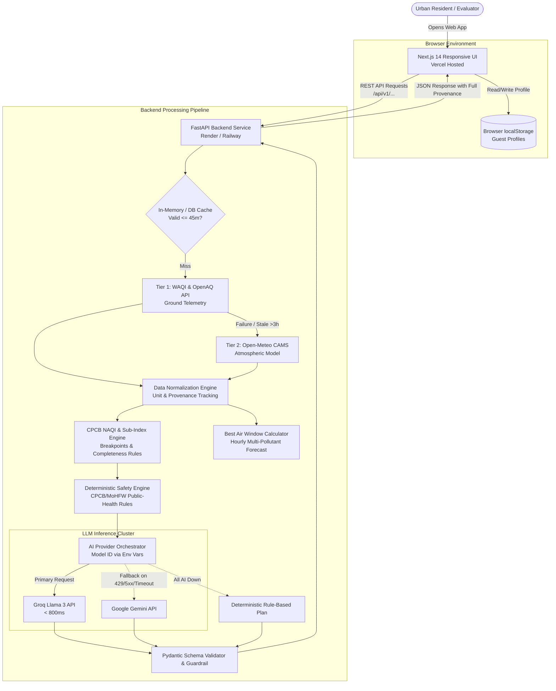

# BreatheWise AI — Product Requirements Document (PRD)

**Document Version:** 1.2  
**Status:** Approved Architecture & Development Baseline (Pre-Implementation Freeze)  
**Project:** PromptWars Virtual — Challenge 6: Urban Air Quality Assistant  
**Product Type:** GenAI-powered, Responsive Web Application (Local-first with Optional Cloud Sync)  
**Target Delivery:** 3-Day Sprint (Hackathon MVP with Production-Ready Foundation)  
**Primary Objective:** Deliver practical, verifiable, and pollution-aware daily lifestyle guidance for Indian households by coupling authoritative multi-tier environmental data with deterministic public-health guardrails and contextual generative AI.

---

## 1. Executive Summary & Product Principles

BreatheWise AI is an Urban Air Quality Assistant designed specifically for urban Indian households. It translates complex atmospheric observations (e.g., particulate concentrations, meteorological inversions, photochemical ozone formation) into actionable daily schedules: *When is the least hazardous window for essential outdoor travel? How should cooking smoke be managed in an apartment kitchen? What commute trade-offs minimize personal particulate inhalation?*

The product operates on a strict **separation of concerns**:
- **Calculations and Public-Health Boundaries are Deterministic:** Environmental data parsing, CPCB sub-index mathematics, and public-health constraint boundaries are executed strictly in deterministic Python code. Generative AI is barred from calculating indices or determining safety boundaries.
- **Generative AI is Contextual and Narrative:** Models (Groq Llama 3 primary, Google Gemini backup) receive pre-validated safety boundaries and focus exclusively on **household routine contextualization, scheduling synthesis, and conversational explanations**.

```
+----------------------------------------------------------------------------------------------------+
|                                    BREATHEWISE AI CORE PILLARS                                     |
+------------------------------------+-----------------------------------+---------------------------+
| 1. Low-Emission Daily Routines     | 2. Indian Indoor Air Intelligence | 3. Sustainable Choices   |
| Practical, pollution-aware travel, | Culturally relevant guidance:     | Practical lower-emission  |
| school, exercise, and errands      | wet mopping vs sweeping, tadka    | transit without increasing|
| scheduled around air conditions.   | exhaust, and safe ventilation.    | personal exposure risk.   |
+------------------------------------+-----------------------------------+---------------------------+
```

### Core Product Principles

1. **Data Before AI:** Outdoor pollutant concentrations and indices must originate from verified providers, never inferred or generated by an LLM.
2. **Deterministic Public-Health Guardrails:** Generative AI is never permitted to declare an activity "safe" or override public-health guidelines. Safety boundaries are calculated deterministically from authoritative references.
3. **Rigorous Scientific Provenance:** Ground observations, atmospheric model estimates, and historical caches must be clearly labeled in the UI. Missing data or unfulfilled averaging criteria must be explicitly disclosed.
4. **Context-Sensitive Guidance (No Rigid Blanket Mandates):** Universal blanket mandates (e.g., rigid fixed ventilation hours, unconditional outdoor bans, universal N95 mandates) are prohibited. Guidance must be graded, source-backed, and practical for Indian living conditions.
5. **Guest-First & Privacy-Preserving:** The application must be instantly usable without mandatory signup or authentication. Sensitive personal and health data is strictly minimized.
6. **Zero Cross-User Plan Leakage:** While public environmental observations are cached globally, personalized daily plans containing user routines are never cached across different users.

---

## 2. Problem Statement & Urban Indian Context

Urban residents across Indian metropolitan areas (Delhi NCR, Mumbai, Bengaluru, Kolkata, Chennai, Hyderabad, etc.) face extreme seasonal and diurnal variations in air quality driven by meteorological inversions, vehicular traffic, construction dust, biomass burning, and cooking practices.

Standard air-quality applications fail Indian households in three distinct ways:
- **Abstract Metric Fatigue:** Displaying "AQI 320" creates anxiety but offers no actionable schedule (e.g., whether pollution will temporarily dip at 2:00 PM).
- **Western Bias in Indoor Guidance:** Advice such as "turn on central HVAC" or "install MERV-13 filters" is irrelevant for typical Indian homes relying on natural cross-ventilation, split ACs, and wet-mopping routines.
- **Unsafe Sustainability Suggestions:** Generic green apps frequently suggest walking or cycling during hazardous pollution episodes, paradoxically increasing heavy particulate inhalation by 300% to 500%.

BreatheWise AI solves these problems through culturally intelligent, deterministic, and exposure-aware planning.

---

## 3. Target Users & Personas

| Persona ID | Target Profile | Key Decisions & Unique Needs |
|---|---|---|
| **Persona A** | **Parent / Household with Children** | Safe outdoor playtime windows; school commute precautions; managing pediatric respiratory sensitivities; indoor particulate control during homework/sleep hours. |
| **Persona B** | **Senior Citizen / Vulnerable Household** | High sensitivity to PM2.5, PM10, and Ozone; early morning walk alternatives; indoor air filtration timing; avoiding strenuous exertion during poor air events. |
| **Persona C** | **Student / Fitness Enthusiast / Athlete** | Timing outdoor running, cycling, or campus commutes; rescheduling workouts to lower-exposure windows or substituting with indoor bodyweight routines. |
| **Persona D** | **Working Professional / Commuter** | Exposure trade-offs between two-wheelers, auto-rickshaws, metro, and cabs; timing office departures; trip consolidation. |
| **Persona E** | **General Urban Resident** | Quick daily orientation; home ventilation timing; basic actionable precautions without complex configuration. |

---

## 4. Scope & Feature Prioritization (P0 / P1 / P2)

To satisfy the 3-day hackathon delivery while building a production-grade core, features are prioritized into strict tiers. **P1 and P2 features must never delay the completion and verification of P0 requirements.**

```
+--------------------------------------------------------------------------------------------------+
| P0: MANDATORY CORE (Days 1 & 2)                                                                  |
| - Multi-tier air quality data ingestion (WAQI -> OpenAQ v3 -> Open-Meteo CAMS -> Unavailable).   |
| - CPCB NAQI calculation engine enforcing data completeness & indicative sub-index distinctions. |
| - Multi-city support (covering major Indian metro centers).                                      |
| - Guest-First onboarding via browser localStorage with pre-configured sample evaluator profiles. |
| - Deterministic Safety Engine enforcing CPCB/MoHFW public-health constraint boundaries.          |
| - Dual AI Provider Architecture: Groq (Llama 3 primary) with automatic Google Gemini fallback.   |
| - Environment-variable driven model identifiers (GROQ_MODEL_ID, GEMINI_MODEL_ID).               |
| - Structured Daily Planner (Morning, Afternoon, Evening) with Post-AI constraint validation.     |
| - Indian Household Intelligence (wet mopping, tadka exhaust management, ventilation precautions).|
| - Sustainable alternatives with exposure trade-off rationale (no unsupported numerical claims).  |
| - Provenance, timestamp, stale data, and error state indicators across all UI cards.             |
+--------------------------------------------------------------------------------------------------+
| P1: HIGH-VALUE ENHANCEMENTS (Day 3 Morning)                                                      |
| - Best Air Window calculation (comparatively favorable ventilation, outdoor, and hazard hours).  |
| - Locality and monitoring station selector for supported metro cities.                           |
| - Optional Supabase Authentication (Google OAuth / Magic Link) for cross-device profile sync.    |
| - 24-hour pollutant trend visualization (Recharts).                                              |
| - Open-Meteo weather context integration (wind speed, temperature, boundary layer/inversion).    |
+--------------------------------------------------------------------------------------------------+
| P2: POST-HACKATHON HORIZON (Postponed)                                                           |
| - Interactive Leaflet GIS maps with real-time station heatmap layers.                            |
| - WhatsApp / SMS proactive push notifications for morning air alerts.                           |
| - Multi-point commute route pollution exposure comparison.                                       |
| - Hardware IoT air purifier integration via MQTT/Home Assistant.                                 |
+--------------------------------------------------------------------------------------------------+
```

---

## 5. Multi-Tier Air Quality Ingestion Architecture

Because Indian air-monitoring feeds can suffer from sporadic telemetry downtime, BreatheWise AI implements a resilient, multi-tier data ingestion pipeline with strict provenance tracking.

```
                           +------------------------------------------+
                           | User Selects City / Station / Locality   |
                           +--------------------+---------------------+
                                                |
                                                v
                           +--------------------+---------------------+
                           | Check In-Memory / Supabase Cache         |
                           | (Freshness window: <= 45 minutes)        |
                           +---------+----------------------+---------+
                                     |                      |
                              [Cache Hit]              [Cache Miss]
                                     |                      |
                                     v                      v
                             Return Cached        +---------+--------------------+
                              Observation         | TIER 1: Ground Station Query |
                                                  | Primary: WAQI API (CPCB/PCB) |
                                                  | Secondary: OpenAQ API v3     |
                                                  +---------+--------------------+
                                                            |
                                               +------------+------------+
                                               |                         |
                                        [Valid Ground Data]       [Failed / Stale >3h]
                                               |                         |
                                               v                         v
                                      Normalize Observation    +---------+--------------------+
                                      Source: "ground_station" | TIER 2: Atmospheric Model    |
                                      Data Status: "live"      | Open-Meteo CAMS Model API    |
                                                               +---------+--------------------+
                                                                         |
                                                            +------------+------------+
                                                            |                         |
                                                    [Valid Model Data]          [Model Failed]
                                                            |                         |
                                                            v                         v
                                                  Normalize Observation     +---------+--------------------+
                                                  Source: "atmospheric_mod"| TIER 3: Unavailable State    |
                                                  Data Status: "model_est"  | Show last known observation  |
                                                                            | tagged "stale_cache" or      |
                                                                            | graceful unavailable card    |
                                                                            +------------------------------+
```

### 5.1 Provider Specifications

| Tier | Provider | Endpoint Pattern | Auth | Response Normalization |
|---|---|---|---|---|
| **Tier 1 (Primary Ground)** | **WAQI API** (aggregating CPCB/SPCB) | `https://api.waqi.info/feed/{city}/?token={KEY}` or `feed/@{station_id}/` | API Key (`token`) | Extracts `iaqi.pm25.v`, `iaqi.pm10.v`, `iaqi.no2.v`, `iaqi.o3.v`, `iaqi.so2.v`, `iaqi.co.v`, `time.iso`, station name, coordinates, attribution (`attributions[].name`). |
| **Tier 1 (Secondary Ground)** | **OpenAQ v3 API** | `https://api.openaq.org/v3/locations/{id}/latest` | Header `X-API-Key` | Fallback if WAQI station is unavailable. Normalizes parameter IDs to standard pollutant concentrations. |
| **Tier 2 (Model Fallback)** | **Open-Meteo Air Quality** (CAMS) | `https://air-quality-api.open-meteo.com/v1/air-quality?latitude={lat}&longitude={lng}&current=pm2_5,pm10,ozone,nitrogen_dioxide&hourly=pm2_5,pm10,ozone,wind_speed_10m` | Open / None | Used when Tier 1 ground stations are missing, offline, or older than 3 hours. Tagged explicitly as `atmospheric_model`. |
| **Tier 3 (Unavailable)** | **Deterministic Fallback** | N/A | None | Displays last cached reading if under 24h old (tagged `stale_cache`), or an explicit error state: *"No active ground stations or atmospheric forecasts available for this area."* |

### 5.2 Strict Provenance & Freshness Requirements
Every API response and database record must preserve and expose the following provenance attributes:
- `source_type`: `Literal["ground_station", "atmospheric_model", "stale_cache", "unavailable"]`
- `data_status`: `Literal["live", "stale", "partial", "unavailable"]`
- `confidence_score`: `Literal["high", "moderate", "low", "unverified"]`
- `observed_at`: Exact ISO-8601 timestamp reported by the measuring instrument or model run.
- `fetched_at`: ISO-8601 timestamp when the backend retrieved the record.

**Rules:**
- **Freshness Window:** Observations are considered **live** if `observed_at` $\le 3\text{ hours}$ old. Observations between 3 and 12 hours old are marked **stale**. Observations older than 12 hours trigger Tier 2 model fallback.
- **Strict Anti-Conflation:** Under no circumstances are ground-station readings blended, averaged, or concatenated with model estimates. The UI badge must unequivocally state either:
  - 🟢 **Live Ground Monitor** (e.g., *"CPCB Ground Telemetry — RK Puram, Delhi"*), or
  - 🔵 **Atmospheric Model Projection** (e.g., *"ECMWF CAMS Regional Atmospheric Model"*).

---

## 6. Official Indian National AQI (NAQI) Methodology & Sub-Index Engine

### 6.1 Complete CPCB NAQI Methodology Specifications
The official Indian National Air Quality Index (NAQI) was developed by the Central Pollution Control Board (CPCB) in collaboration with IIT Kanpur (2014). It evaluates up to **8 designated criteria pollutants**:
$\text{PM}_{10}, \text{PM}_{2.5}, \text{NO}_2, \text{SO}_2, \text{CO}, \text{O}_3, \text{NH}_3, \text{Pb}$.

#### Official Indian Breakpoints Table

| Category | Sub-Index Range | $\text{PM}_{10}$ (24h) $\mu\text{g/m}^3$ | $\text{PM}_{2.5}$ (24h) $\mu\text{g/m}^3$ | $\text{NO}_2$ (24h) $\mu\text{g/m}^3$ | $\text{O}_3$ (8h) $\mu\text{g/m}^3$ | $\text{CO}$ (8h) $\text{mg/m}^3$ | $\text{SO}_2$ (24h) $\mu\text{g/m}^3$ | $\text{NH}_3$ (24h) $\mu\text{g/m}^3$ | $\text{Pb}$ (24h) $\mu\text{g/m}^3$ |
|---|---|---|---|---|---|---|---|---|---|
| **Good** | 0 – 50 | 0 – 50 | 0 – 30 | 0 – 40 | 0 – 50 | 0.0 – 1.0 | 0 – 40 | 0 – 200 | 0.0 – 0.5 |
| **Satisfactory** | 51 – 100 | 51 – 100 | 31 – 60 | 41 – 80 | 51 – 100 | 1.1 – 2.0 | 41 – 80 | 201 – 400 | 0.6 – 1.0 |
| **Moderate** | 101 – 200 | 101 – 250 | 61 – 90 | 81 – 180 | 101 – 168 | 2.1 – 10.0 | 81 – 380 | 401 – 800 | 1.1 – 2.0 |
| **Poor** | 201 – 300 | 251 – 350 | 91 – 120 | 181 – 280 | 169 – 208 | 10.1 – 17.0 | 381 – 800 | 801 – 1200 | 2.1 – 3.0 |
| **Very Poor** | 301 – 400 | 351 – 430 | 121 – 250 | 281 – 400 | 209 – 748* | 17.1 – 34.0 | 801 – 1600 | 1201 – 1800 | 3.1 – 3.5 |
| **Severe** | 401 – 500 | $> 430$ | $> 250$ | $> 400$ | $> 748$* | $> 34.0$ | $> 1600$ | $> 1800$ | $> 3.5$ |

*\*Note on Ozone ($O_3$): CPCB specifies 8-hourly averages for normal ranges (0–208 $\mu\text{g/m}^3$) and 1-hour monitoring for extreme episodic spikes (209–748+ $\mu\text{g/m}^3$).*

#### Linear Interpolation Formula
For each pollutant $p$, its sub-index $I_p$ is calculated as:
$$I_p = I_{low} + \frac{I_{high} - I_{low}}{B_{high} - B_{low}} \times (C_p - B_{low})$$
Where:
- $C_p$ is the pollutant concentration.
- $[B_{low}, B_{high}]$ is the concentration breakpoint bracket enclosing $C_p$.
- $[I_{low}, I_{high}]$ is the corresponding sub-index bracket.

### 6.2 Data Completeness & Indicative Sub-Index Rules
According to CPCB technical guidelines (CPCB NAQI Report, 2014):
1. **Averaging Period Requirements:**  
   - 24-hourly pollutants ($\text{PM}_{10}, \text{PM}_{2.5}, \text{NO}_2, \text{SO}_2, \text{NH}_3, \text{Pb}$) require at least **16 hours (66.7%)** of valid data within the 24-hour window.
   - 8-hourly pollutants ($\text{CO}, \text{O}_3$) require at least **6 hours (75%)** of valid data within the 8-hour window.
2. **Minimum Pollutant Criterion:**  
   The overall NAQI is defined as the maximum of individual sub-indices:
   $$\text{NAQI} = \max(I_1, I_2, \dots, I_n)$$
   **Crucial Rule:** An overall NAQI can **only** be declared if:
   - At least **three pollutants** have valid, data-complete sub-indices.
   - At least one of the three must be a particulate pollutant ($\text{PM}_{2.5}$ or $\text{PM}_{10}$).

### 6.3 Scientific Labeling & Disclosures
Because real-time consumer APIs (like WAQI or OpenAQ) frequently return instantaneous hourly or near-real-time readings rather than verified 24-hour time-weighted averages meeting the 16-hour completeness rule, BreatheWise AI enforces the following labeling rules:

| Condition Met | Required UI Display Label | Methodology Disclosure |
|---|---|---|
| Complete 24h averages with $\ge 3$ pollutants (incl. $\text{PM}_{2.5}$ or $\text{PM}_{10}$) and $\ge 16\text{h}$ completeness | **"Official Indian National AQI"** | *"Calculated per full CPCB methodology using 24-hour time-weighted averages across qualifying criteria pollutants."* |
| Real-time hourly feed with $\text{PM}_{2.5}$ and/or $\text{PM}_{10}$ present, but incomplete 24h time-series or $<3$ pollutants | **"Indicative Particulate Sub-Index"** | *"Real-time hourly estimate calculated using official CPCB particulate breakpoints. Complete 24h multi-pollutant NAQI requires $\ge 16\text{h}$ of data across $\ge 3$ pollutants."* |
| Provider reports converted index (e.g., WAQI US EPA conversion) | **"Provider Index (US EPA Scale)"** | *"Reported by external provider using US EPA index conventions; raw concentrations displayed below."* |
| Model-derived values (Open-Meteo CAMS) | **"Atmospheric Model Sub-Index Estimate"** | *"Simulated particulate sub-index derived from ECMWF CAMS regional atmospheric reanalysis model."* |

---

## 7. Deterministic Safety Rules Engine & Public-Health Sources

BreatheWise AI implements a deterministic safety rules engine in pure Python. The engine translates calculated sub-index bands and household vulnerability into **contextual, configurable constraints** before calling the LLM. 

### 7.1 Authoritative Public-Health References
The safety matrix and rules are derived directly from:
1. **Central Pollution Control Board (CPCB) NAQI Report (2014):** *Health Statements Associated with NAQI Categories* (Table 4).
2. **Ministry of Health and Family Welfare (MoHFW), Govt of India (2019):** *National Programme on Climate Change and Human Health (NPCCHH) - Public Health Advisory on Air Pollution*.
3. **World Health Organization (WHO) Global Air Quality Guidelines (2021):** *Risk Assessment for Particulate Matter and Ozone*.
4. **Indian Council of Medical Research (ICMR) & AIIMS Guidelines:** *Clinical Advisory for Respiratory and Cardiovascular Vulnerable Populations*.

### 7.2 Contextual Public-Health Guidance Matrix (No Blanket Mandates)

Rather than rigid blanket bans (e.g., "nobody can leave the house", "N95 mandatory everywhere"), the guidance is structured into **graded, contextual advisories**:

| Band | CPCB Health Descriptor | General Population Advisory | Vulnerable Groups Advisory (Pediatric, Geriatric, Pre-existing Cardiac/Respiratory) | Ventilation Advisory | Commute & Mask Advisory |
|---|---|---|---|---|---|
| **Good (0–50)** | Minimal impact. | Normal outdoor activities and exercise encouraged. | Normal outdoor activities encouraged. | Natural cross-ventilation encouraged throughout the day. | Walking, cycling, and active transit recommended. No mask required. |
| **Satisfactory (51–100)** | Minor breathing discomfort to sensitive people. | Normal outdoor physical activities suitable. | Sensitive individuals should observe respiratory symptoms during prolonged intense exertion. | Open windows suitable throughout the day. | Active transit suitable. Sensitive individuals note high-traffic corridors. |
| **Moderate (101–200)** | Breathing discomfort to people with lungs, asthma and heart diseases. | Prolonged strenuous outdoor exertion may cause fatigue; schedule periodic rest intervals. | Avoid prolonged strenuous outdoor physical exertion; consider moving high-intensity workouts indoors. | Window opening suitable; consider closing windows during peak morning/evening traffic spikes. | Walking/cycling acceptable. Sensitive individuals may use surgical/cloth masks for coarse road dust. |
| **Poor (201–300)** | Breathing discomfort to most people on prolonged exposure. | Reduce prolonged strenuous outdoor workouts; shift strenuous cardio indoors. | Avoid outdoor physical exercise. Children and seniors avoid prolonged outdoor exposure. | Ventilate briefly only during midday dispersion periods; keep closed during dawn/evening inversion. | For prolonged transit or two-wheeler commutes, a well-fitted particulate respirator (N95/FFP2) is advised. |
| **Very Poor (301–400)** | Respiratory illness on prolonged exposure. | Avoid outdoor running and intense exertion. Keep outdoor transit to essential needs. | Remain indoors where feasible. Children should not participate in outdoor sports. Keep inhalers accessible. | Keep windows closed. If indoor stuffiness requires air exchange, ventilate briefly during the diurnal minimum. | N95/FFP2 particulate respirators strongly advised for all outdoor transit. Prefer closed public transit (Metro). |
| **Severe (401–500+)** | Affects healthy people and seriously impacts those with existing diseases. | Strictly avoid non-essential outdoor physical exertion. Work from home where feasible. | Strict indoor sheltering advised. Vulnerable individuals monitor peak expiratory flow / oxygen saturation. | Keep windows and doors sealed. Run HEPA air filtration if available. Wet-mop indoor floors to suppress dust. | Avoid outdoor travel unless unavoidable. N95/FFP2 respirator essential for outdoor transit. Use closed vehicles. |

### 7.3 Deterministic Safety Pre-Constraints & Post-AI Validation Hook

```python
class SafetyConstraints(BaseModel):
    calculated_band: str
    outdoor_exertion_level: Literal["unrestricted", "moderate_with_breaks", "light_only", "avoid_strenuous", "avoid_all"]
    vulnerable_activity_restriction: Literal["none", "monitor_symptoms", "indoor_only", "strict_shelter"]
    ventilation_guidance: Literal["unrestricted", "close_traffic_peaks", "midday_only", "sealed_preferred"]
    respirator_advisory: Literal["none", "optional_dust_zones", "n95_advised_prolonged", "n95_strongly_advised"]
    indoor_mitigation_required: bool
    fallback_indoor_activity: str

def validate_and_sanitize_plan(plan: DailyPlanResponse, constraints: SafetyConstraints) -> DailyPlanResponse:
    """Post-AI Guardrail: Intercepts and rewrites LLM recommendations violating constraints."""
    for period in [plan.morning, plan.afternoon, plan.evening]:
        for rec in period:
            # Overrule high exertion when outdoor activity is restricted
            if constraints.outdoor_exertion_level in ["avoid_strenuous", "avoid_all"] and rec.is_outdoor and rec.intensity in ["moderate", "high"]:
                rec.action = constraints.fallback_indoor_activity
                rec.caution = "Activity adjusted to indoor low-exertion by BreatheWise Safety Engine due to elevated pollution."
                rec.is_outdoor = False
                rec.intensity = "light"
            # Ensure respirator advisory is noted during open transit in Poor+ bands
            if constraints.respirator_advisory in ["n95_advised_prolonged", "n95_strongly_advised"] and rec.commute_context and "mask" not in rec.action.lower():
                rec.caution = (rec.caution or "") + " Note: Well-fitted N95/FFP2 respirator advised during open transit."
    return plan
```

---

## 8. Best Air Window Feature (P1)

BreatheWise AI introduces a data-driven **"Best Air Window"** recommendation card.

```
+----------------------------------------------------------------------------------------------------+
| BEST AIR WINDOW TODAY                                                   [Status: Comparative Est.]  |
+----------------------------------------------------------------------------------------------------+
| 🟢 Comparatively Better Window: 01:30 PM – 03:30 PM (Expected: Moderate, ~75 µg/m³)                |
|    Rationale: Solar boundary layer expansion temporarily disperses surface particulate matter.     |
|    Action: Preferred window for essential outdoor errands and brief cross-ventilation.             |
|                                                                                                    |
| 🔴 Peak Hazard Window: 06:30 AM – 09:00 AM (Expected: Very Poor, ~180 µg/m³)                       |
|    Rationale: Morning surface temperature inversion traps vehicular and biomass emissions.          |
|    Action: Keep windows sealed; avoid outdoor physical exertion.                                  |
+----------------------------------------------------------------------------------------------------+
```

### 8.1 Multi-Pollutant & Meteorological Calculation Logic
1. **Multi-Pollutant Ingestion:** Hourly forward projections from **Open-Meteo Air Quality** for $\text{PM}_{2.5}$, $\text{PM}_{10}$, and Ozone ($O_3$).
2. **The Ozone Precaution:** In sunny Indian summer months, ground-level Ozone ($O_3$) frequently surges between 12:00 PM and 4:00 PM due to photochemical reactions, even when $\text{PM}_{2.5}$ drops. The engine evaluates composite exposure:
   $$E(t) = \max\left(I_{\text{PM2.5}}(t), I_{\text{PM10}}(t), I_{\text{O3}}(t)\right)$$
3. **Weather Context Integration:** Evaluates wind speed ($>2.5\,\text{m/s}$ facilitates dispersion) and boundary layer height projections.
4. **The Comparative Safety Terminology Rule (Safeguard B):**
   - The lowest forecasted pollutant hour **must never be equated with a universally safe period**.
   - If composite sub-indices remain $\ge 201$ (Poor, Very Poor, Severe), the window **must** be rendered as **"Comparatively Better Window"** or **"Lowest Exposure Window"**, accompanied by:  
     *"Air quality remains in the unhealthy range; this window represents the diurnal minimum for necessary tasks."*
5. **Insufficient Input Fallback:** If hourly forecast data is missing, model confidence is low, or parameters are incomplete, return `air_window_status: "unavailable"` with the explanation: *"Hourly atmospheric dispersion forecast unavailable for this area today. Follow general daily precautions."*

---

## 9. Indian Household Intelligence (P0)

BreatheWise AI incorporates specific, practical indoor air guidance designed for Indian urban residences, grounded in aerosol physics and building science:

1. **Wet Mopping (*Pocha*) vs. Dry Sweeping (*Jharoo*):**
   - Dry sweeping with traditional grass brooms resuspends settled coarse dust ($\text{PM}_{10}$) and deposited particulate matter into the domestic breathing zone for 2 to 4 hours.
   - Guidance: Recommend **wet mopping with a damp microfiber cloth** to physically trap settled particles without aerosolizing them into indoor air.
2. **Cooking Emissions & High-Heat *Tadka*:**
   - High-heat oil tempering (*tadka* with mustard oil, ghee, dry chilies) causes rapid thermal breakdown and violent oil aerosolization, causing indoor $\text{PM}_{2.5}$ concentrations to spike over $500\,\mu\text{g/m}^3$ within minutes.
   - Guidance: Run kitchen exhaust fans or chimneys on high speed before heating oil; keep the kitchen door closed to prevent smoke dispersion into bedrooms; maintain adequate exhaust cross-draft.
3. **Contextual Ventilation Timing (No Fixed Universal Hours):**
   - Rather than rigid universal timings (e.g., "always open windows from 1:30 PM to 3:30 PM"), ventilation guidance is **contextual**:
     - *Winter Morning Inversion:* Advise against early morning dawn ventilation (5:30 AM – 8:30 AM) when cold air traps emissions at ground level.
     - *Midday Dispersion:* Advise checking the live dashboard for the *Comparatively Better Window* before opening windows for air exchange.
     - *High-Traffic Corridors:* For homes facing arterial roads, advise closing windows during peak vehicular rush hours (8:00 AM – 10:30 AM and 6:00 PM – 9:00 PM).
4. **Air Purifiers & Natural Plants Disclosure:**
   - Purifiers: Advise running HEPA purifiers in closed bedrooms during night hours; clean the pre-filter mesh every 2 weeks.
   - Scientific Honesty: Clarify that common houseplants (Snake Plant, Areca Palm) cannot meaningfully cleanse ambient indoor particulate matter ($\text{PM}_{2.5}$) at real-world residential ventilation rates (NASA Clean Air Study limitations).

---

## 10. AI Provider Architecture & Resilient Failover

```
                     +---------------------------------------------+
                     | Frontend / Client Request                   |
                     +----------------------+----------------------+
                                            |
                                            v
                     +----------------------+----------------------+
                     | FastAPI AI Manager (ai_manager.py)          |
                     | Injects Validated Data + Safety Constraints |
                     +----------------------+----------------------+
                                            |
                     +----------------------+----------------------+
                     | PRIMARY ATTEMPT: Groq API                   |
                     | Model: ${GROQ_MODEL_ID}                     |
                     | Timeout: 4500ms                             |
                     +----------------------+----------------------+
                                            |
                               +------------+------------+
                               |                         |
                           [Success]               [Eligible Failure]
                               |                   - Timeout / Connection Fail
                               |                   - HTTP 429 Rate Limit
                               |                   - HTTP 500 / 502 / 503
                               |                         |
                               |                         v
                               |           +-------------+--------------------+
                               |           | BACKUP ATTEMPT: Google Gemini    |
                               |           | Model: ${GEMINI_MODEL_ID}        |
                               |           | Timeout: 6000ms                  |
                               |           +-------------+--------------------+
                               |                         |
                               |            +------------+------------+
                               |            |                         |
                               v            v                     [Failure]
                     +---------+------------+----+                    |
                     | Pydantic Schema Validator |                    v
                     | Post-AI Constraint Guard  |        +-----------+--------------------+
                     +---------------------------+        | DETERMINISTIC FALLBACK PLAN    |
                                                          | Pre-computed safe guidance     |
                                                          | based entirely on CPCB matrix. |
                                                          +--------------------------------+
```

### 10.1 Configurable Environment Variables & Model Compatibility
Model identifiers are decoupled from application code and managed via environment variables:
- `GROQ_MODEL_ID`: Default `llama-3.3-70b-versatile` (or `llama-3.1-8b-instant`).
- `GEMINI_MODEL_ID`: Default `gemini-1.5-flash` (or `gemini-2.0-flash`).

### 10.2 Failover & Error Classification

| Condition | Groq Action | Gemini Fallback Action | Final Result |
|---|---|---|---|
| HTTP 200 (Valid JSON) | Validate schema $\rightarrow$ return | Not called | Personalized AI Plan |
| HTTP 429 (Rate Limit) | Catch exception $\rightarrow$ switch | Invoke immediately | Gemini Plan |
| Timeout (>4.5s) | Cancel request $\rightarrow$ switch | Invoke with 6.0s timeout | Gemini Plan |
| HTTP 5xx Server Error | Log error category $\rightarrow$ switch | Invoke immediately | Gemini Plan |
| Both Providers Fail | Catch exception | Log provider outage | **Deterministic Rule-Based Fallback Plan** (Zero crash) |
| HTTP 400 (Bad Request) | **Do not fallback**; prompt schema error | **Do not fallback** | Return HTTP 500 internal error |
| HTTP 401/403 (Invalid Key) | **Do not fallback**; config error | **Do not fallback** | Log alert; trigger deterministic plan |

### 10.3 Cache Architecture & User Privacy
- **Public Observations Cache:** Raw environmental readings from WAQI and Open-Meteo are cached in backend memory or Supabase for **30 to 45 minutes** keyed by `station_id` or `city`.
- **Zero Cross-User Plan Caching:** **Personalized AI plans are never cached across different users.** Because plans contain custom family routines, commute timings, and vulnerability profiles, sharing plans between users risks severe privacy leakage.
- **Client-Side Cache:** The client browser caches its *own* generated daily plan in `localStorage` for the current calendar date to eliminate redundant API calls upon page reload.

---

## 11. Technical Architecture & Component Stack

### 11.1 Technology Stack Table

| Layer | Selection | Rationale & Trade-off Consideration |
|---|---|---|
| **Frontend Framework** | **Next.js 14+ (App Router, TypeScript)** | High performance, server-side rendering for meta tags, typed component tree. |
| **Styling & UI Library** | **Tailwind CSS + shadcn/ui + Lucide Icons** | Accessible, responsive, mobile-first design with clean visual hierarchy. |
| **State & Storage** | **Browser `localStorage` (Zustand optional)** | Zero-friction Guest-First onboarding; zero evaluator login barriers. |
| **Backend Framework** | **FastAPI (Python 3.11+)** | Native async I/O, strict Pydantic v2 data models, fast execution. |
| **Data Validation** | **Pydantic v2** | Strict schema validation for external APIs and generative AI JSON payloads. |
| **Primary AI Inference** | **Groq API (`${GROQ_MODEL_ID}`)** | Blazing inference speed (<700ms TTFT), generous hackathon tier. |
| **Backup AI Inference** | **Google Gemini API (`${GEMINI_MODEL_ID}`)** | High uptime, large context window, reliable structured JSON mode. |
| **Ground Air Quality** | **WAQI API + OpenAQ API v3** | Real-time CPCB/SPCB ground telemetry with attribution provenance. |
| **Atmospheric Model & Weather**| **Open-Meteo Air Quality & Weather API** | Free, unauthenticated CAMS model fallback and hourly forward forecasts. |
| **Database & Auth (Optional P1)**| **Supabase (PostgreSQL + RLS)** | Hosted PostgreSQL for observation history and optional user profile sync. |
| **Visual Charts** | **Recharts** | Clean responsive SVG 24-hour pollutant and diurnal curve visualization. |
| **Frontend Hosting** | **Vercel** | Instant continuous deployment, Edge network, zero cold starts. |
| **Backend Hosting** | **Render (Free Tier) / Railway / Koyeb** | Fast Docker/Python deployment with cold-start mitigation pinger. |

### 11.2 End-to-End System Architecture



---

## 12. Pydantic Response Schemas & Data Contracts

These schemas are the single source of truth for backend serialization, AI output validation, and frontend rendering.

```python
from pydantic import BaseModel, Field
from typing import List, Optional, Literal
from datetime import datetime

# ==============================================================================
# 1. AIR QUALITY & PROVENANCE SCHEMAS
# ==============================================================================

class PollutantConcentration(BaseModel):
    value: float = Field(..., description="Observed or estimated numerical value")
    unit: str = Field(default="µg/m³", description="Measurement unit (e.g., µg/m³, mg/m³)")
    averaging_period_hours: int = Field(default=1, description="Averaging period of the input data (1, 8, or 24)")
    sub_index: Optional[float] = Field(None, description="Calculated CPCB sub-index for this pollutant")

class NormalizedAirObservation(BaseModel):
    city: str
    locality_or_station: Optional[str] = None
    station_distance_km: Optional[float] = None
    
    # Rigorous Provenance Tracking
    source_type: Literal["ground_station", "atmospheric_model", "stale_cache", "unavailable"]
    data_provider: str = Field(..., description="e.g., 'WAQI (CPCB Feed)', 'OpenAQ', 'Open-Meteo CAMS'")
    observed_at: datetime
    fetched_at: datetime
    data_status: Literal["live", "stale", "partial", "unavailable"]
    confidence_score: Literal["high", "moderate", "low", "unverified"]
    
    # Official vs Indicative Index Distinctions
    index_type: Literal[
        "official_cpcb_naqi", 
        "indicative_particulate_subindex", 
        "provider_index", 
        "atmospheric_model_estimate", 
        "unavailable"
    ]
    index_value: Optional[int] = None
    index_category: Literal["Good", "Satisfactory", "Moderate", "Poor", "Very Poor", "Severe", "Unavailable"]
    methodology_disclosure: str = Field(..., description="Transparent explanation of how index was determined")
    
    # Raw Pollutant Readings
    pm25: Optional[PollutantConcentration] = None
    pm10: Optional[PollutantConcentration] = None
    no2: Optional[PollutantConcentration] = None
    so2: Optional[PollutantConcentration] = None
    co: Optional[PollutantConcentration] = None
    o3: Optional[PollutantConcentration] = None

# ==============================================================================
# 2. HOUSEHOLD PROFILE & SAFETY CONSTRAINTS
# ==============================================================================

class HouseholdProfile(BaseModel):
    profile_id: str
    display_name: Optional[str] = "My Household"
    city: str
    preferred_station_id: Optional[str] = None
    persona: Literal["parent", "senior", "athlete", "commuter", "general"]
    age_groups: List[Literal["infant_toddler", "child", "adult", "senior"]]
    has_respiratory_sensitivity: bool = False
    has_cardiovascular_sensitivity: bool = False
    commute_mode: Optional[Literal["two_wheeler", "open_auto", "metro_train", "closed_car", "walking", "none"]] = None
    has_air_purifier: bool = False
    kitchen_ventilation_type: Literal["exhaust_fan", "chimney", "window_only", "none"] = "exhaust_fan"

class SafetyConstraints(BaseModel):
    calculated_band: str
    outdoor_exertion_level: Literal["unrestricted", "moderate_with_breaks", "light_only", "avoid_strenuous", "avoid_all"]
    vulnerable_activity_restriction: Literal["none", "monitor_symptoms", "indoor_only", "strict_shelter"]
    ventilation_guidance: Literal["unrestricted", "close_traffic_peaks", "midday_only", "sealed_preferred"]
    respirator_advisory: Literal["none", "optional_dust_zones", "n95_advised_prolonged", "n95_strongly_advised"]
    indoor_mitigation_required: bool
    fallback_indoor_activity: str

# ==============================================================================
# 3. BEST AIR WINDOW & DAILY PLAN SCHEMAS
# ==============================================================================

class AirWindowItem(BaseModel):
    time_window: str = Field(..., description="e.g., '01:30 PM - 03:30 PM' or 'Not recommended today'")
    is_favorable: bool = Field(..., description="True if window represents meaningful exposure reduction")
    expected_aqi_band: str = Field(..., description="e.g., 'Moderate', 'Poor'")
    rationale: str = Field(..., description="Atmospheric explanation (e.g., boundary layer expansion)")
    actionable_instruction: str = Field(..., description="Action to take during this window")

class BestAirWindowResponse(BaseModel):
    status: Literal["available", "comparative_only", "unavailable"]
    confidence_level: Literal["high", "moderate", "low", "unavailable"]
    ventilation_window: Optional[AirWindowItem] = None
    safe_outdoor_window: Optional[AirWindowItem] = None
    peak_hazard_window: Optional[AirWindowItem] = None
    advisory_note: str = Field(..., description="Safeguard B disclaimer regarding comparative safety")

class PlanRecommendation(BaseModel):
    action: str
    timing: str
    reason: str
    is_outdoor: bool
    intensity: Literal["none", "light", "moderate", "high"] = "none"
    caution: Optional[str] = None
    data_context_used: str

class DailyPlanResponse(BaseModel):
    generated_at: datetime
    ai_provider_used: Literal["groq", "gemini", "deterministic_fallback"]
    data_provenance: NormalizedAirObservation
    safety_constraints: SafetyConstraints
    best_air_windows: Optional[BestAirWindowResponse] = None
    
    # 3-Period Daily Routine (P0)
    morning: List[PlanRecommendation]
    afternoon: List[PlanRecommendation]
    evening: List[PlanRecommendation]
    
    # Challenge Pillars (P0)
    indoor_guidance: List[str]
    sustainable_alternatives: List[str]
    scientific_disclaimers: List[str]
```

---

## 13. Guest-First & Local Storage Data Model

To eliminate onboarding friction for users and evaluators, BreatheWise AI operates **100% functional without user login**.

```
+----------------------------------------------------------------------------------------------------+
| LOCALSTORAGE SCHEMA: 'breathewise_guest_state'                                                      |
+----------------------------------------------------------------------------------------------------+
{
  "selected_city": "Delhi NCR",
  "preferred_station_id": "cpcb_rk_puram_delhi",
  "profile": {
    "profile_id": "guest_550e8400_e29b",
    "persona": "parent",
    "age_groups": ["child", "adult"],
    "has_respiratory_sensitivity": true,
    "commute_mode": "two_wheeler",
    "has_air_purifier": true,
    "kitchen_ventilation_type": "exhaust_fan"
  },
  "cached_plan": {
    "date": "2026-11-24",
    "plan_payload": { ... }
  }
}
```

### Pre-Configured Sample Evaluator Profiles
The onboarding modal includes a single-click **"Load Sample Profile"** selector:
1. **Sample 1: Delhi NCR Family (High Vulnerability)** — 6-year-old child with mild asthma, two-wheeler school commute, exhaust fan present. Demonstrates severe AQI safety overrides.
2. **Sample 2: Bengaluru Runner (Athlete)** — Outdoor morning fitness enthusiast, metro commuter. Demonstrates outdoor exercise window rescheduling.
3. **Sample 3: Mumbai Senior Citizen** — 68-year-old walking enthusiast, ground-floor apartment. Demonstrates indoor ventilation and gentle morning alternatives.

---

## 14. Database Schema (Optional Supabase P1)

When Supabase is enabled for user persistence in P1, the following PostgreSQL schema with Row Level Security (RLS) is applied:

```sql
-- Profiles table (synced when user logs in via Supabase Auth)
CREATE TABLE public.profiles (
    id UUID PRIMARY KEY REFERENCES auth.users(id) ON DELETE CASCADE,
    display_name TEXT,
    city TEXT NOT NULL DEFAULT 'Delhi NCR',
    persona TEXT NOT NULL CHECK (persona IN ('parent', 'senior', 'athlete', 'commuter', 'general')),
    household_config JSONB NOT NULL DEFAULT '{}'::jsonb,
    created_at TIMESTAMPTZ NOT NULL DEFAULT timezone('utc'::text, now()),
    updated_at TIMESTAMPTZ NOT NULL DEFAULT timezone('utc'::text, now())
);

ALTER TABLE public.profiles ENABLE ROW LEVEL SECURITY;
CREATE POLICY "Users can only read own profile" ON public.profiles FOR SELECT USING (auth.uid() = id);
CREATE POLICY "Users can only update own profile" ON public.profiles FOR UPDATE USING (auth.uid() = id);
CREATE POLICY "Users can insert own profile" ON public.profiles FOR INSERT WITH CHECK (auth.uid() = id);

-- Global Air Quality Observation Cache (Public read, Service write)
CREATE TABLE public.air_quality_cache (
    id UUID PRIMARY KEY DEFAULT gen_random_uuid(),
    station_or_city_key TEXT NOT NULL UNIQUE,
    provider TEXT NOT NULL,
    source_type TEXT NOT NULL,
    raw_payload JSONB NOT NULL,
    observed_at TIMESTAMPTZ NOT NULL,
    fetched_at TIMESTAMPTZ NOT NULL DEFAULT timezone('utc'::text, now())
);

CREATE INDEX idx_air_cache_key ON public.air_quality_cache(station_or_city_key);
ALTER TABLE public.air_quality_cache ENABLE ROW LEVEL SECURITY;
CREATE POLICY "Public read access to air cache" ON public.air_quality_cache FOR SELECT TO anon, authenticated USING (true);
```

---

## 15. API Specifications (FastAPI Endpoints)

| Method | Endpoint | Purpose | Request Body / Query Params | Response Object |
|---|---|---|---|---|
| `GET` | `/health` | Service health & wake-up check | None | `{"status": "ok", "timestamp": "...", "version": "1.2"}` |
| `GET` | `/api/v1/cities` | List supported Indian metro cities & default coordinates | None | `List[CityMetadata]` |
| `GET` | `/api/v1/stations` | List available monitoring stations for a city | `?city=Delhi+NCR` | `List[StationMetadata]` |
| `GET` | `/api/v1/air-quality` | Retrieve normalized live/fallback air observations | `?city=Delhi&station_id=...` | `NormalizedAirObservation` |
| `GET` | `/api/v1/air-window` | Retrieve calculated 24h best air windows (P1) | `?city=Delhi&lat=...&lng=...` | `BestAirWindowResponse` |
| `POST`| `/api/v1/plan/generate`| Generate personalized daily plan with safety constraints | `HouseholdProfile` + Air context | `DailyPlanResponse` |

---

## 16. Edge Cases & Resilience Engineering

| Edge Case Scenario | System Response & Required UI Behavior |
|---|---|
| **Selected city has zero active ground stations** | Fall back to Tier 2 (Open-Meteo CAMS atmospheric model). Badge: *"Atmospheric Model Estimate"*. Disclose lack of local ground sensor. |
| **WAQI station reports stale data (>3 hours old)** | Flag as `stale_cache`. Query Open-Meteo model. If model is fresher, display model reading with clear comparison disclosure. |
| **Ground station provides real-time PM2.5/PM10 but lacks 24h completeness** | Calculate CPCB particulate sub-index. Label as **"Indicative Particulate Sub-Index"**. Disclose that official multi-pollutant NAQI requires 24h time-series. |
| **Open-Meteo hourly forecast fails / times out** | `best_air_windows` returns `status: "unavailable"`. UI collapses the window card gracefully and relies on daily plan periods. |
| **Groq API hits HTTP 429 Rate Limit** | Automatically divert payload to Google Gemini within 200ms. Response headers record `x-ai-provider: gemini-fallback`. |
| **Both Groq and Gemini APIs are down** | Invoke `deterministic_fallback_planner()`. Output complete, safe, structured daily plan based strictly on the CPCB safety matrix. |
| **Render backend is in cold-start state (~50s)** | Frontend landing page executes a warming `/health` ping on load; shows a branded wake-up indicator: *"BreatheWise AI is activating real-time air engines (~20s)..."* |
| **Evaluator opens app without profile configuration** | UI defaults to Guest Mode with pre-populated "Sample Delhi Family" state; app is 100% interactive on first click. |
| **User submits prompt-injection text in profile label** | Profile fields are strongly validated by Pydantic; strings are escaped; LLM system prompt isolates user text within strict JSON variables. |

---

## 17. Security, Privacy & Public Health Disclaimers

### 17.1 Security & Secret Management
- **Zero Secrets on Client:** Groq API keys, Gemini API keys, WAQI tokens, and Supabase service keys remain exclusively on the FastAPI backend.
- **Environment Isolation:** Keys stored in `.env` (git-ignored); `.env.example` committed with empty placeholders.
- **CORS Restrictions:** FastAPI configured with strict CORS origins allowing only the deployed Vercel domain and `localhost:3000`.

### 17.2 Mandatory Public Health Disclaimer (Safeguard C)
The following persistent disclaimer must be accessible in the web application footer and within the generated plan modal:

> **Important Public Health Advisory:**  
> *"BreatheWise AI provides environmental information and lifestyle exposure-reduction guidance based on available ground and satellite telemetry. It is not an authorized medical device, clinical diagnostic tool, or emergency broadcast service. Air quality and atmospheric conditions vary significantly across micro-environments. Individuals with pre-existing respiratory or cardiovascular conditions should prioritize personalized guidance from qualified healthcare professionals."*

---

## 18. References & Authoritative Public-Health Sources

1. **Central Pollution Control Board (CPCB), Ministry of Environment, Forest and Climate Change, Govt of India (2014):**  
   *National Air Quality Index Report*. Developed by CPCB and IIT Kanpur. [http://cpcb.nic.in/displaypdf.php?id=bmFxaS9uYXFpLnBkZg==]
2. **Ministry of Health and Family Welfare (MoHFW), Govt of India (2019):**  
   *National Programme on Climate Change and Human Health (NPCCHH) - Public Health Advisory on Air Pollution*. [https://main.mohfw.gov.in/]
3. **World Health Organization (2021):**  
   *WHO Global Air Quality Guidelines: Particulate matter (PM2.5 and PM10), ozone, nitrogen dioxide, sulfur dioxide and carbon monoxide*. World Health Organization, Geneva.
4. **Indian Council of Medical Research (ICMR) & AIIMS (2020):**  
   *Health Effects of Air Pollution and Clinical Guidelines for Vulnerable Cohorts*. ICMR Task Force Report.
5. **Copernicus Atmosphere Monitoring Service (CAMS) / ECMWF (2024):**  
   *Global and Regional Atmospheric Composition Reanalysis Documentation*.

---

## 19. Unresolved Technical Dependencies & Pre-Implementation Verification

The following items are designated as **unresolved dependencies** to be verified during Day 1 setup, rather than making unverified assumptions:

1. **WAQI Real-Time Endpoint Rate Limit:**  
   *Status:* Unresolved.  
   *Task:* Verify free token per-minute and per-day rate limits for target Indian cities (Delhi, Mumbai, Bengaluru, Hyderabad) during Day 1 API testing.
2. **Open-Meteo Hourly Ozone ($O_3$) Accuracy in Indian Terrains:**  
   *Status:* Unresolved.  
   *Task:* Compare Open-Meteo forecasted hourly Ozone with CPCB ground telemetry in Delhi to confirm whether summer photochemical spikes are adequately captured.
3. **Groq Model Active Deprecation Status:**  
   *Status:* Resolved via environment variable (`GROQ_MODEL_ID`). Must verify live inference on `llama-3.3-70b-versatile` or `llama-3.1-8b-instant`.
4. **Gemini 2.0 Flash Quota Status:**  
   *Status:* Resolved via environment variable (`GEMINI_MODEL_ID`). Default to `gemini-1.5-flash` or `gemini-2.0-flash` based on project quota.
5. **Backend Host Spin-Down Behavior:**  
   *Status:* Unresolved.  
   *Task:* Verify whether Render free-tier synthetic cron pinging maintains active state, or switch immediately to Railway/Koyeb if cold-starts persist.

---

## 20. Three-Day Development Sprint Roadmap

```
+----------------------------------------------------------------------------------------------------+
| DAY 1: FOUNDATION & MULTI-TIER DATA INGESTION                                                      |
| [ ] Initialize Next.js 14 frontend and FastAPI backend repositories.                              |
| [ ] Implement WAQI API integration with station-level parsing.                                    |
| [ ] Implement Open-Meteo CAMS fallback integration.                                               |
| [ ] Build Normalization Engine & CPCB NAQI Sub-Index Calculator (Safeguard A).                    |
| [ ] Construct responsive Dashboard shell with City selector and provenance badges.                 |
| [ ] Day 1 Exit Gate: User can select Delhi, Mumbai, or Bengaluru and view real-time data or       |
|     transparent model fallbacks with clear data status badges.                                     |
+----------------------------------------------------------------------------------------------------+
| DAY 2: INTELLIGENCE, SAFETY ENGINE & AI FAILOVER                                                   |
| [ ] Build Guest-First onboarding with browser localStorage persistence.                           |
| [ ] Add 3 one-click sample evaluator profiles (Parent, Athlete, Senior).                          |
| [ ] Implement Deterministic Safety Rules Engine (CPCB/MoHFW constraint matrix).                   |
| [ ] Implement Groq Llama 3 primary client (model via GROQ_MODEL_ID).                              |
| [ ] Implement Gemini backup client (model via GEMINI_MODEL_ID).                                   |
| [ ] Implement Post-AI validation guardrail & deterministic fallback generator.                    |
| [ ] Implement Indian Household Intelligence (wet mopping, tadka exhaust, etc.).                    |
| [ ] Day 2 Exit Gate: Selecting a profile generates a personalized 3-period daily plan that        |
|     respects safety constraints across both Groq and Gemini.                                       |
+----------------------------------------------------------------------------------------------------+
| DAY 3: BEST AIR WINDOW, POLISH, VERIFICATION & DEPLOYMENT                                         |
| [ ] Implement Best Air Window calculation from Open-Meteo hourly projections (Safeguard B).        |
| [ ] Add 24-hour visual trend charts using Recharts.                                               |
| [ ] Complete responsive accessibility and mobile layout pass.                                     |
| [ ] Deploy Frontend to Vercel and Backend to Render/Railway.                                       |
| [ ] Configure uptime ping monitor on `/health` to eliminate cold-start sleep.                     |
| [ ] Record 2-3 minute comprehensive demo video.                                                    |
| [ ] Complete GitHub README and publish LinkedIn build-in-public post.                              |
| [ ] Day 3 Exit Gate: Complete, live, publicly accessible URL ready for challenge submission.      |
+----------------------------------------------------------------------------------------------------+
```

---

## 21. Definition of Done & Challenge Verification

BreatheWise AI is verified ready for PromptWars Challenge 6 submission when:

- [ ] **Multi-City Support:** Selectable across at least 4 Indian cities (e.g., Delhi NCR, Mumbai, Bengaluru, Hyderabad).
- [ ] **Multi-Tier Ingestion Verified:** Live WAQI ground data displays; disconnecting network gracefully transitions to Open-Meteo model estimate with appropriate badges.
- [ ] **Indian NAQI Safeguard A Verified:** Real-time hourly readings without full 24h series are accurately labeled as *"Indicative Particulate Sub-Index"*, not the official multi-pollutant NAQI.
- [ ] **Deterministic Safety Engine Verified:** Testing an extreme AQI (>400) profile forces outdoor activities to be canceled, regardless of LLM generation.
- [ ] **Groq + Gemini Failover Verified:** Forcing an invalid Groq key or timeout automatically triggers the Gemini backup without user-facing error.
- [ ] **Best Air Window Safeguard B Verified:** Lowest pollution hours in severe conditions are labeled "Comparatively Better Window", never "Safe".
- [ ] **Guest-First Usability Verified:** A fresh incognito browser can test all features and load sample profiles with zero login screens.
- [ ] **Zero Cross-User Leakage:** Shared plan cache is disabled; only raw environmental data is cached.
- [ ] **Deployed & Accessible:** Live Next.js app on Vercel communicates with live backend on Render/Railway.
- [ ] **Documentation Complete:** GitHub repository documented with architectural diagrams; LinkedIn post and screen demo link verified.
