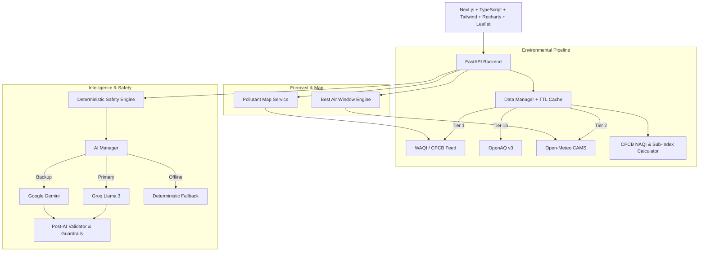

# BreatheWise AI — Urban Air Quality & Personalized Exposure Assistant

**PromptWars Virtual Challenge 6** | *Production-oriented environmental telemetry, deterministic public-health safety guardrails, and personalized daily routine intelligence for Indian metropolitan cities.*

---

## 1. Problem Statement & Solution Overview

Urban air pollution in Indian metropolitan regions varies sharply by hour, locality, and pollutant composition ($PM_{2.5}$, $PM_{10}$, $O_3$, $NO_2$, $SO_2$, $CO$, $NH_3$, $Pb$). Residents often lack actionable, localized guidance tailored to their household vulnerabilities (asthma/COPD, children, seniors), commute mode (open two-wheeler vs. enclosed Metro), and indoor routines (high-heat *tadka* cooking vs. exterior ventilation).

**BreatheWise AI** bridges raw atmospheric telemetry and daily decision-making without sacrificing scientific integrity:
- **Zero-Fabrication Environmental Pipeline:** Never invents sensor data, distinguishes official CPCB NAQI from real-time indicative sub-indices and atmospheric model estimates, and flags stale telemetry.
- **Deterministic Public-Health Safety Engine:** Authoritative CPCB (2014) and MoHFW NPCCHH (2019) rules execute *before* and *after* any generative AI call, overruling unsafe outdoor exertion recommendations.
- **Multi-Pollutant Best Air Window Engine:** Evaluates 24–48h Open-Meteo / ECMWF CAMS hourly forecasts to identify comparatively better diurnal windows without ever declaring polluted air "safe".

---

## 2. Key Features

1. **Multi-City Telemetry Dashboard:** Live air-quality tracking across **Delhi NCR, Mumbai, Bengaluru, Hyderabad, Kolkata, and Chennai** with all 8 CPCB criteria pollutants.
2. **3-Tier Data Provenance Pipeline:**
   - **Tier 1 (Ground Stations):** WAQI (CPCB feed) primary, OpenAQ v3 secondary.
   - **Tier 2 (Atmospheric Model):** Open-Meteo CAMS fallback (explicitly labeled `atmospheric_model_estimate`).
   - **Tier 3 (Unavailable State):** Clean fallback UI when telemetry is unreachable.
3. **Interactive Pollutant Distribution Map:** Leaflet + OpenStreetMap visualization displaying real monitoring station coordinates, station-level sub-indices, stale-reading indicators, and accurate reporting vs. total station counts.
4. **Best Air Window Engine:** Computes hourly comparative pollution scores $E(t) = \max(I_p(t))$ across $PM_{2.5}, PM_{10}, O_3, NO_2, SO_2, CO$ and renders an interactive 24-hour Recharts curve with activity-specific suitability and safety interlocks.
5. **Personalized Daily Planner (Dual-Provider AI + Deterministic Fallback):**
   - **Primary:** Groq (`llama-3.3-70b-versatile`)
   - **Backup:** Google Gemini (`gemini-1.5-flash`)
   - **Offline Safety Fallback:** Pure-Python deterministic routine generator if both LLMs fail or hit rate limits.
   - Integrates hourly Best Air Window forecast context, indoor cooking/sweeping mitigation (*pocha* vs *jharoo*), and sustainable mobility trade-offs.

---

## 3. System Architecture



---

## 4. Technology Stack

- **Frontend:** Next.js 16 (App Router, Turbopack), TypeScript, Tailwind CSS, Recharts, Leaflet + OpenStreetMap, Lucide Icons.
- **Backend:** Python 3.11+, FastAPI, Pydantic v2, HTTPX (async).
- **AI Providers:** Groq API, Google Gemini API (configurable via environment variables).
- **Environmental Data:** WAQI API, OpenAQ API v3, Open-Meteo Air Quality (CAMS) & Weather APIs.
- **Testing:** Pytest (`46/46` tests passing), Next.js TypeScript & Production Build verification.

---

## 5. Safety & Scientific Design

- **Official NAQI vs. Indicative Sub-Index:** Official Indian NAQI requires 24-hour/8-hour averages and $\ge 3$ pollutants (including $PM_{2.5}$ or $PM_{10}$) with sufficient data completeness. Real-time hourly snapshots are transparently labeled `indicative_particulate_subindex` or `atmospheric_model_estimate`.
- **No Unconditional Medical Mandates:** Respirator guidance (N95/FFP2) is contextualized for prolonged open transit (two-wheelers, open autos, walking) under Poor/Very Poor/Severe conditions rather than blanket mandates.
- **Comparative Window Labeling:** Forecast periods strictly use `"Lowest Forecast Pollution Period"`, `"Comparatively Better Window"`, and `"Higher Pollution Period"`. Strenuous outdoor cardio is automatically disallowed when $E(t) > 300$.

---

## 6. Local Setup & Execution

### Prerequisites
- Python 3.11+
- Node.js 20+
- API Keys (server-side only): `WAQI_API_TOKEN`, `OPENAQ_API_KEY`, `GROQ_API_KEY`, `GEMINI_API_KEY`

### 1. Environment Configuration
Copy `.env.example` to `.env` in the repository root and populate your server-side keys:
```bash
cp .env.example .env
```
*(Never commit `.env` or place API secrets into `NEXT_PUBLIC_*` variables.)*

### 2. Run Backend (FastAPI)
```bash
cd backend
python -m venv venv
# Windows: .\venv\Scripts\activate | macOS/Linux: source venv/bin/activate
pip install -r requirements.txt
uvicorn app.main:app --host 127.0.0.1 --port 8000 --reload
```
Verify health endpoint: `http://127.0.0.1:8000/health`

### 3. Run Frontend (Next.js)
```bash
cd frontend
npm install
# Optional: set NEXT_PUBLIC_API_URL=http://127.0.0.1:8000 in frontend/.env.local
npm run dev
```
Open `http://localhost:3000`.

### 4. Run Automated Tests
```bash
# Backend test suite (46 tests)
cd backend
pytest -v

# Frontend TypeScript & Production Build
cd frontend
npm run build
```

---

## 7. Production Deployment

- **Frontend (Vercel):** Configured via `frontend/vercel.json`. Set `NEXT_PUBLIC_API_URL` in Vercel Project Settings to your deployed backend URL.
- **Backend (Render / Docker):** Configured via `backend/Dockerfile` and `render.yaml` with `/health` check. Set `WAQI_API_TOKEN`, `OPENAQ_API_KEY`, `GROQ_API_KEY`, `GEMINI_API_KEY`, and `ALLOWED_ORIGINS` (your Vercel domain) in Render Environment Variables.

---

## 8. Known Limitations

- Hourly real-time station feeds do not always provide full 24-hour historical series on free-tier endpoints, so live snapshots display a clearly labeled `indicative_particulate_subindex` rather than an official 24h CPCB NAQI.
- Atmospheric chemistry forecasts (Open-Meteo CAMS) operate at regional grid resolution (~11–40 km) and may not capture hyper-local street-canyon or construction dust spikes.
- Free-tier LLM rate limits (e.g., Groq HTTP 429) trigger automatic failover to Gemini or the deterministic Python routine generator, increasing latency on failover.
